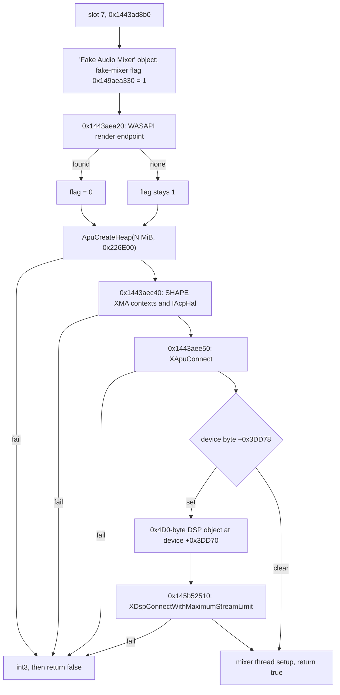

# Audio runtime

How the game starts its audio and what it needs from the console's audio hardware. The sound data itself is in
[audio.md](audio.md). Addresses are in `game_scarlett_master.exe` (base 0x140000000).

The engine mixes on the CPU and plays through WASAPI, but it does not decode on the CPU: Opus goes to the audio
processor through `xapu.dll` and XMA to the SHAPE XMA decoders through `acphal.dll`. The executable holds no Opus or
XMA decoder (no libopus tables, no `opus` strings) and imports no XAudio2. Bink video sound is the exception:
Bink decodes it and hands it to the game's mixer. A PC port therefore has to supply the
decoders; the loader runs the Opus queue on the CPU (`src/FiveStar.Loader/Shims/Apu`).

## Start-up

The audio device's vtable is 0x1465f4900; slot 7 (0x1443ad8b0) starts it:

Every hardware failure ends in an `int3` before `return false`, so a failing shim does not silence the game: it
stops it at a breakpoint. The WASAPI step is the only optional one.

| Step | Call site | What the game does |
|---|---|---|
| WASAPI | 0x1443aea6a | `CoCreateInstance(CLSID_MMDeviceEnumerator, CLSCTX_ALL)`, registers an endpoint callback, enumerates active render endpoints (looks for headphones or a headset by form factor), takes the default console endpoint; 0x141e7f5ed activates `IAudioClient` and reads its mix format |
| APU heap | 0x1443ad933 | `ApuCreateHeap(size << 20, 0x226E00)` |
| SHAPE contexts | 0x1443aec73 | `AcpHalAllocateShapeContexts` with only the fifth count set: 350 contexts, the XMA decoders |
| XMA buffers | 0x1443aed13 | one `ApuAlloc(0x222E00)`, cut into 350 pairs of 0x1700 bytes (XMA output) and 0x200 bytes |
| IAcpHal | 0x1443aed98 | `AcpHalCreate(&hal)`, `hal->slot0(0x1000, 0x1000)`, an event, then `hal->slot2(2, 0xF0F0F0F0, -1, &0xC0, 0)` |
| XApu | 0x1443aee69 | `XApuConnect(&config, &sharedMemory, &handle)`; the 0x18-byte config is set statically (0x145a87962) |
| XDsp | 0x145b5262e | when the device byte at +0x3DD78 is set, which it is on a normal boot; see [XDsp protocol](#xdsp-protocol) |

XAudio2 (`XAudio2_9.dll` in the boot log) is an import of `Bink2Scarlett.dll` (ordinal 1, `XAudio2Create`) and goes
unused: the game passes `BinkSetSoundSystem` its own open function (0x145f172c0 returns 0x141a9b300), which
fills Bink's 0x1C0-byte sound channel with the game's callbacks, so video sound is decoded by Bink on the CPU and
mixed by the game's engine.

## What the hardware does for the game

| Unit | Use | Evidence |
|---|---|---|
| XApu (`xapu.dll`) | Opus decode: 99.9% of the game's sounds | the Opus voice (format codec 0x0B, 48 kHz, 960-sample frames, 0x144ee99e0) sends one command per packet |
| SHAPE XMA (`acphal.dll`) | XMA2 decode | 350 XMA contexts; the CPU copies 16-bit PCM out of each context's 0x1700-byte output buffer (0x140078120) and acknowledges it with an IAcpHal message |
| SHAPE SRC, EQ, filter, DMA | not used | their context counts stay 0 |
| XDsp (`chad.dll`) | convolution effects on 1024-frame blocks (the executable names `Convolution_` and `Spatial_Reverb`) | activation configs and the command loop, below |
| Mixing, rate conversion, effects | CPU | the decoded PCM goes into the voice's ring buffer (0x144e64f00); output is WASAPI |

### XApu protocol

`XApuEnqueueCommand(handle, command*, 0)` takes a 0x40-byte command; each command is answered by one 0x40-byte
result that the game collects every audio frame with `XApuGetResultCount(handle, 0)` and `XApuDequeueResult`
(0x144eaa840). Results carry the command's type and stream.

| Offset | Size | Command field |
|---|---|---|
| 0x00 | 4 | Type: 1 create, 2 destroy, 3 decode, 5 reset |
| 0x04 | 4 | Stream (the game's numbers, below 0x100) |
| 0x18 | 4 | Create: a value from the voice; decode: 0 |
| 0x1C | 4 | Decode: float from the voice, meaning unknown |
| 0x20 | 4 | Decode: value from the voice, meaning unknown |
| 0x24 | 4 | Decode: samples per channel of a frame, 960 |
| 0x28 | 4 | Decode: packet bytes (the AWC u16 length prefix stripped) |
| 0x2C | 8 | Decode: packet address (unaligned) |
| 0x34 | 4 | Decode: output capacity, channels * 0xF00 |
| 0x38 | 8 | Decode: output address |

The shared memory `XApuConnect` returns holds per decode slot (below 0x80) a 0x280-byte packet staging area at
slot * 0x280 and a 0x1E00-byte output area at 0x14000 + slot * 0x1E00. A decode result's u32 at +0x34 is the bytes of
32-bit float PCM written, channels interleaved; the game multiplies by 32767 and packs to 16-bit.

The game's stream states (table at 0x149ae8c90): 1 creating, 2 resetting, 3 destroying, 4 ready, 5 decoded. A
create result moves 1 to 4, a decode result 4 to 5, a reset result 2 to 4, a destroy result frees the stream.

### XDsp protocol

The DSP object (constructor 0x145f0b960) allocates a 0x60000-byte pool (`XMemAlloc`, 0x141d6bdf0), zeroes it in
0x1000-byte pages and keeps them as input/output page pairs: 8 pairs in the first 0x10000 bytes, 40 pairs of
adjacent pages after them. It then connects and keeps the handle at +0x488; +0x4C8 is set when the connect succeeds,
and every effect asks 0x144e5b020 for the object only while it is set.

| Call | Call site | Arguments |
|---|---|---|
| `XDspConnectWithMaximumStreamLimit` | 0x145b5262e | pool, 0x60000, streams (0x18 or 0x1E, chosen by 0x140075140), 0x80, 1, `&handle`; succeeds only on 0 |
| `XDspActivate` | 0x1411d475d | handle, config, `&status`, `&stream`; succeeds only on 0 |
| `XDspSubmitCommand` | 0x144e5b20d | stream, command, `&id`; succeeds only on 0 |
| `XDspDeactivate` | 0x141166020 | stream |
| `XDspDisconnect` | 0x1443aea00 | handle |

Activation configs, as the two activation sites fill them:

| Offset | Size | Convolution (0x14003b97e) | Other kind (0x1443b3966) |
|---|---|---|---|
| 0x00 | 4 | 1 | 2 |
| 0x04 | 4 | 0, 2, 8 or 10 (from the effect's settings) | 0 |
| 0x08 | 4 | 1024 (frames per block) | 1024 |
| 0x0C | 4 | 1 or 2 (channels, inferred) | 1 |
| 0x10 | 4 | impulse response length in floats | 0 |
| 0x14 | 8 | impulse response address | 0 |

A command is 0x20 bytes: two floats of 1.0 at +0x00 and +0x04, the input pages' address at +0x08, the output pages'
address at +0x10, 0 at +0x18. The game copies a block into the input page, submits, and stores the returned id. It
never waits: every audio frame it reads the status record the activation returned, and takes the output only when
the u32 at +0x04 (the completed count) equals the last id and the u32 at +0x0C is 0; the completed count minus the
blocks already taken is how many output blocks are ready (0x1443b3cc0). The convolution's state machine
(0x1443b2a40) zeroes its output whenever a result is not ready, so a late DSP result is silence, not a stall.
## On the PC

| Call | Loader |
|---|---|
| `ApuCreateHeap`, `ApuAlloc` and the address functions | one committed region ([loader.md](loader.md)) |
| `AcpHalAllocateShapeContexts` | XMA contexts from the APU heap; any other context kind E_NOTIMPL |
| `AcpHalCreate` | an IAcpHal object: slot 0, 1 and 2 return S_OK (messages logged once per type), slots 3 and 4 E_NOTIMPL, slot 5 releases |
| `AcpHalReleaseShapeContexts` | frees the contexts |
| `XApuConnect` and the queue | a CPU queue: a command runs when enqueued and its result waits for the poll. Opus decodes with Concentus at 48 kHz, one decoder per stream kept across packets; the channel count comes from the output capacity |
| `XDsp*` | streams on the CPU: a command completes when it is submitted (id = completed count, written to the stream's status record); no effect runs and the output pages stay as the game zeroed them, so XDsp effects return silence |

What a complete replacement still needs: XMA2 decoding behind the SHAPE contexts, the XDsp convolution (the impulse
response format and whether the output is a wet send or an in-place insert are not confirmed), and a check that WASAPI on the PC accepts the format the game asks for. The XMA2 decoder exists
(XmaStreamDecoder, [xma.md](xma.md)); what is missing is the context protocol. Wiring it in means, per enabled
context: read its input packets, call DecodePacket per 2 KiB packet, pack the float output to 16-bit PCM into the
context's 0x1700-byte output buffer in 256-byte blocks, and advance the write offset the game reads. The hook is
AcpHalDevice.SendMessage, where the per-context messages (5, 7, 0x12) arrive.

## Unknown

- The meaning of the create value (+0x18) and the decode fields +0x1C and +0x20 (perhaps pitch and pre-skip);
  the XApu config struct; other result fields.
- The SHAPE_CONTEXTS layout beyond the XMA count (+0x10) and pointer (+0x38): six u32 counts and one pointer per
  kind are inferred from those two offsets.
- The XMA context bit fields (the game reads offsets in 256-byte blocks from +0x00 and +0x24 and the output buffer's
  APU address from +0x1C); the IAcpHal message types (2 at start-up, 5, 7 and 0x12 per XMA context) and slots 3, 4.
  Those three fields and the 64-byte size sit where the Xbox 360 XMA context, as emulators describe it, keeps the
  output write offset (dword 0), output buffer pointer (dword 7) and output read offset (dword 9); whether the rest
  (input buffer pointers and packet counts, loop fields) matches as well is not checked.
- Who sets the XDsp byte at +0x3DD78; the XDsp connect arguments 0x80 and 1; config +0x04; which effect kind 2
  selects (perhaps `Spatial_Reverb`); the two 1.0 command floats (perhaps input and output gain); the status record
  fields other than +0x04 and +0x0C.
- How the game behaves when an XMA context never produces output.
