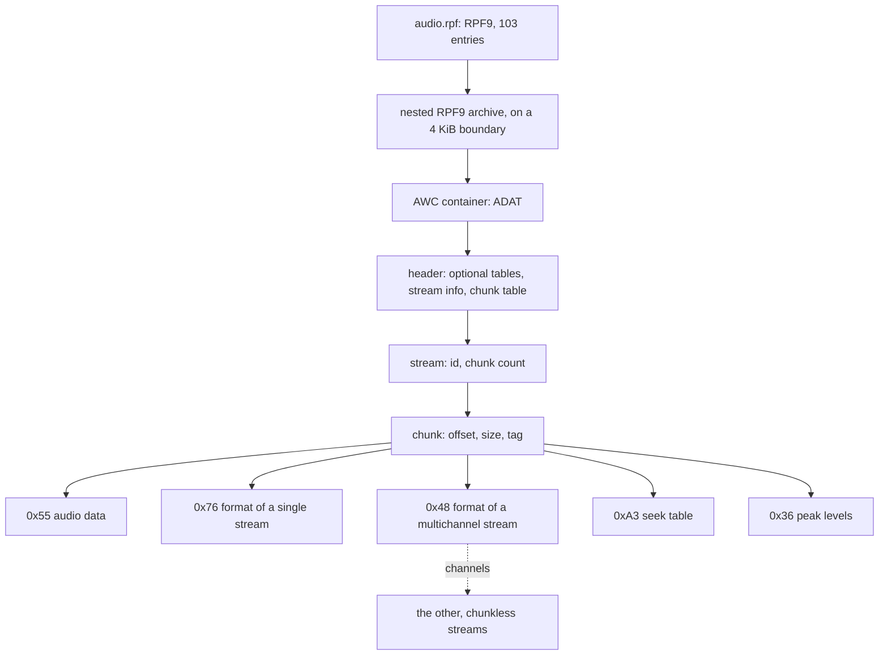

# Audio

`audio.rpf` (26.6 GiB) holds the game's sound banks as AWC containers stored raw: no zlib and no encryption.
`fivestar audio` finds them without the archive's table of contents, checks every stream and exports playable files.

## Archive layout

`audio.rpf` is an RPF9 archive ([archives.md](archives.md)) with 103 entries. Its entries are RPF9 archives
themselves: 103 nested `RPF9` headers sit on 4 KiB boundaries, each with its own encrypted table of contents. Their
entries are AWC containers, which start with `ADAT`.



| Found | Count | Bytes |
|---|---|---|
| AWC containers | 7,160 (7,159 on a 4 KiB boundary, one on a 16-byte boundary) | 26.55 GiB, 99.87% of the archive |
| Streams with audio | 1,603,231 | 22.69 GB of audio data |

The rest is the nested archive headers and padding.

## Container header

All values little-endian. Offsets are from the `ADAT` magic.

| Offset | Size | Meaning |
|---|---|---|
| 0x00 | 4 | `ADAT` |
| 0x04 | 2 | Version: 1 |
| 0x06 | 2 | Flags; the high byte is always 0xFF |
| 0x08 | 4 | Stream count |
| 0x0C | 4 | End of the chunk table (the header size) |
| 0x10 | | Optional tables chosen by the flags, in this order: |
| | 4 | flag 0x40: a u32 that equals the offset of one of the chunks; meaning unknown |
| | 2 per stream | flag 0x01: index of the stream's first chunk |
| | 4 per stream, plus 4 | flag 0x20: unknown words; the first is 0x04xxxxxx in all 5,089 such containers |
| | 4 per stream | Stream info: id in bits 0..28, chunk count in bits 29..31; sorted by id (4 containers repeat an id) |
| | 8 per chunk | Chunk entry: offset in bits 0..27, size in bits 28..55, tag in bits 56..63 |

| Flags | Containers |
|---|---|
| 0xFF25 | 3,008 (each holds one multichannel stream; flag 0x04) |
| 0xFF02 | 2,071 (no optional tables) |
| 0xFF21 | 1,271 |
| 0xFF61 | 810 |

Every container's tables add up exactly to the header size, and every chunk lies inside the archive. The container
ends at its furthest chunk.

## Chunks

| Tag | Content |
|---|---|
| 0x55 | Audio data |
| 0x76 | Format of a single stream (0x20 bytes, below) |
| 0x48 | Format of a multichannel stream (below) |
| 0xA3 | Seek table: one u32 start sample per 2 KiB page, then one more value |
| 0x36 | Peak levels |
| 0xBD, 0x5C, 0xB2, 0x5A, 0xD9, 0x68 | Not read (markers, animation, granular grains and loops, and others) |

Format chunk (0x76):

| Offset | Size | Meaning |
|---|---|---|
| 0x00 | 4 | Sample count, all channels together |
| 0x04 | 4 | Loop point (-1: no loop) |
| 0x08 | 2 | Sample rate field |
| 0x0A | 2 | Headroom (signed) |
| 0x0C | 16 | Unknown |
| 0x1C | 1 | Codec |
| 0x1D | 1 | Channel count (1 or 2) |
| 0x1E | 2 | Unknown |

## Codecs

| Codec | Format | Streams | Data bytes |
|---|---|---|---|
| 0x0B | Opus | 1,601,167 | 22,526,814,198 |
| 0x05 | XMA2 | 1,818 | 102,309,888 |
| 0x02 | 32-bit float PCM | 227 | 58,417,152 |
| 0x00 | 16-bit PCM | 19 | 283,686 |

The PCM codecs take exactly 2 and 4 bytes per sample. XMA2 data is a run of 2 KiB packets whose headers have the
XMA2 layout (frame count, first-frame offset), with 512 samples per frame.

### Opus data

The data is a run of 2 KiB pages. A page holds whole packets, each after a u16 length, and ends with zero padding.
Every packet's table-of-contents byte is valid (RFC 6716), and every stream's first packet has the stereo bit its
channel count asks for.

- The sample count counts samples at the Opus rate of 48 kHz, whatever the sample rate field says (32,000 for
  1,066,527 streams, 48,000 for 534,576). For all 1,601,167 streams and channels the packets decode to 1,920 to
  2,879 more samples per channel than the header's count.
- Decoded audio is silent up to about sample 312 (measured over 373 streams), the delay of the reference Opus encoder.
  The export uses a pre-skip of 312.
- 20,471 streams are stereo; the sample count then counts both channels.

### Multichannel streams

A multichannel stream has id 0 and a 0x48 chunk instead of 0x76; its channels are the other, chunkless streams.

| Offset | Size | Meaning |
|---|---|---|
| 0x00 | 4 | Block count |
| 0x04 | 4 | Block size (0x80000 in 2,979 of 3,008; also 0x1E000, 0x1B9000, 0x73800, 0x1B000) |
| 0x08 | 4 | Channel count (1 in 2,958; up to 8) |
| 0x0C | 16 per channel | u32 id, u32 sample count, i16 headroom, u16 sample rate field, u8 codec, u8 channel count, u16 unknown |

The data chunk is a run of blocks; the last is cut short. A block starts with 0x18 bytes per channel (u32 0xFFFFFFFF,
u32 page count, u32 skip, u32 sample count, two u32 zero), then each channel's seek table (u32 per page: the page's
start sample on the stream's timeline), zero padding to 2 KiB, then each channel's pages in channel order. A block may
start before the previous one ended; the packets before that end are dropped. All 3,116 channels are Opus.

## Export

```
fivestar audio scan   <audio.rpf> [--limit N]                       coverage per codec
fivestar audio export <audio.rpf> <out> [--limit N] [--codec C] [--from X]
```

`export` writes `<out>/<container offset>/<stream id>.<ext>` (`<stream id>_1` and so on when a container repeats an
id). `--from` takes a container offset in hex.

| Codec | File |
|---|---|
| Opus | `.opus`: Ogg Opus, one file per stream or multichannel channel, pre-skip 312, trimmed to the sample count |
| XMA2 | `.wav` with an XMA2WAVEFORMATEX header (format tag 0x166) |
| PCM | `.wav` |
| Other | `.codecXX.raw`: the data chunk as stored (none in this dump) |

All 1,603,231 streams read cleanly. Checked with FFmpeg over 639 exported files from all codecs, including stereo
and multichannel ones: every file decodes without an error, Opus and PCM to exactly the header's sample count, XMA2
to 384 to 768 samples fewer.

## Unknown

- What the sample rate field means for Opus streams when it is not 48,000.
- Whether the encoder delay is exactly 312 samples; the containers do not store it.
- The flag 0x02, the u32 of flag 0x40, the words of flag 0x20, and the unknown format fields.
- The last seek table entry of a single stream, and the skip field of a block.
- Stream names. In earlier RAGE games the id is the low 29 bits of the name's hash; no names are in the dump.
