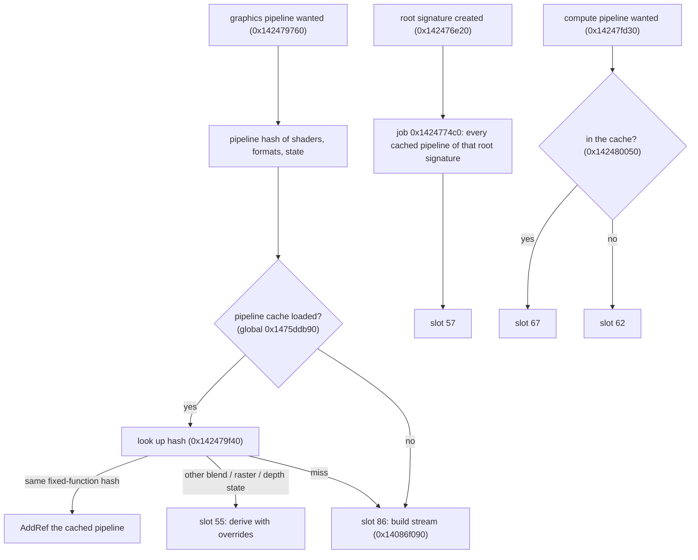
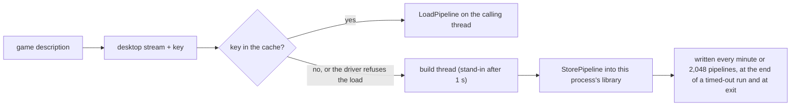
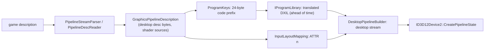

# D3D12.X pipeline creation

How the game creates pipeline states on the D3D12.X device and how the loader turns them into desktop
`ID3D12PipelineState` objects. Read from `game_scarlett_master.exe` (image base 0x140000000); slot numbers are device
vtable slots ([d3d12x-shim.md](d3d12x-shim.md)). Items marked *inferred* follow from how the game fills or uses a
value, not from a header. Code: `src/FiveStar.Loader/Shims/D3D12X/Pipelines`.

## The five slots

Every call passes `ID3D12PipelineState`'s IID (0x1461e06b8) and an out pointer last.

| Slot | Offset | Call site | Arguments after the device | Description |
|---|---|---|---|---|
| 55 | 0x1B8 | 0x14247a5c2 | base pipeline, u32 count, override array, IID, out | derive from a cached pipeline (below) |
| 57 | 0x1C8 | 0x142477578 | cache description (0x108 bytes), IID, out | graphics pipeline of the pipeline cache |
| 62 | 0x1F0 | 0x14247fe66 | `D3D12_COMPUTE_PIPELINE_STATE_DESC`, 0, 0, IID, out | compute pipeline; the two extra arguments are always 0 |
| 67 | 0x218 | 0x1424800d5 | cache description (0x48 bytes), IID, out | compute pipeline of the pipeline cache |
| 86 | 0x2B0 | 0x142479a87 | `D3D12_PIPELINE_STATE_STREAM_DESC`, IID, out | graphics pipeline from a stream (desktop `ID3D12Device2::CreatePipelineState`) |

Slot 101 (0x1424813ef, state-object IID) creates the ray-tracing state object and is not covered here.

A graphics result is stored at +0x38 of the game's pipeline object (and bit 7 of +0x1D set), a compute result at
+0x120. Cached pipelines are kept in the cache's hash map as `pointer >> 1` and AddRef'ed on every hit.

## Creation jobs

Compute pipelines are created in deferred jobs. Loading a compute shader (0x140f9f650: bytecode read, root signature
at +0x118) takes an item from a pool of 32 (0x140f9fbd0), sets its callback 0x14247fd00 and the shader object at
+0x20 and queues it (0x1450f6bb0). The item counts in the pool counter 0x1475e8eb0.

| Function | Does |
|---|---|
| 0x14247fd00 | runs 0x14247fd30 for the shader object, then 0x140699390; returns 1 whatever the result |
| 0x14247fd30 | slot 67 when the cache has the program (0x142480050), else slot 62; on failure releases the root signature and leaves +0x120 at 0 |
| 0x140699390 | returns the item to the pool and decrements 0x1475e8eb0; at 0x80000001 it sets the event at 0x1475e8eb8 |
| 0x1458044a0 | waits until the pool is empty: adds 0x80000000 to the counter and waits for the event when jobs are left |

A task of the frame graph calls 0x1458044a0 (from 0x142499630), so the frame does not end while a creation runs. A
failed creation still completes its job, but the game later reads +0x10 to +0x2F of the pipeline at +0x120 without a
null check (0x14248c700; 0x14248c30d reads +0x10 of it): the console never fails here. Every creation slot (55, 57,
62, 67, 86) therefore answers a creation that gives no pipeline (driver failure, missing program, unreadable
description) with S_OK and a stand-in that never builds (`StandInPipelines.Unbuilt`); the failure is still counted
by cause in the sample summary, and the work recorded with it stays skipped. A failed compute pipeline in the story
mode load reached the game as null and faulted at 0x14248c30d. The cached graphics pipelines of a root signature
(0x1424774c0, slot 57) are created in jobs too.

### Stand-ins

The desktop driver compiles a translated program in seconds and the largest ones (the screen-probe and ray-traced
shadow compute programs, 5 to 10 MB of DXIL) in minutes; with a cold shader cache the frame waited for all of them.
`StandInPipelines` runs every creation of slots 55, 57, 62, 67 and 86 on the threads of a `PipelineBuildQueue` (half
the logical processors):

| Case | The game gets |
|---|---|
| done within `PipelineSlots.CreationBudget` (1 s) and no creation queued before it | the desktop pipeline or the failure |
| still running, or queued behind others | S_OK and a stand-in |

A stand-in is our own `ID3D12PipelineState` (`StandInPipelineObject`): a vtable, the desktop pipeline once built
(0 before), 0x20 zero bytes the game reads, its own reference count. Its last Release releases the desktop pipeline,
or the build does when it ends later. Slot 25 of the command list (SetPipelineState) sets the built pipeline; while
it is not built the list sets nothing and drops its draws, dispatches and ExecuteIndirect calls until the next
SetPipelineState (counted in the sample summary). A derive (slot 55) from a stand-in uses the description kept
under the stand-in's address; the rectangle-list variant is made from the built pipeline.

Memory while builds wait (a cold story load queues thousands):

| Item | Rule |
|---|---|
| Queued stream | keeps its subobjects and references the programs' DXIL; the native copy the driver reads is made for the cache lookup and again for the build, and freed while the stream waits in the queue (`DesktopStream.Release`) |
| DXIL | `TranslatedProgramLibrary` keeps the most recently used programs up to 1 GiB and reads older ones again; rectangle-list recipes keep program names, not DXIL |
| Build start | waits while less than 8 GB of commit is available (`WarmMemoryGuard`, as in the warm-up), since one driver compile can take gigabytes |

### Disk cache

The driver's own shader cache stores a compile only once it finishes, so a boot that ends before the largest
programs are built compiles them again next time. `PipelineLibraryCache` keeps every built desktop pipeline in
`ID3D12PipelineLibrary1` files in `--pipeline-cache <dir>` (default `<work-dir>\pipeline-cache`; `--no-pipeline-cache`
turns it off).

| Item | Rule |
|---|---|
| Key (pipeline name) | the first 16 bytes of a SHA-256 over the stream: each subobject's type and payload, the DXIL itself in place of shader pointers, the input element count and the elements' semantic names and fields; the root signature is left out (the salt covers it). Everything the loader substitutes (renamed input elements, render-target and depth format substitutes, the program variant's DXIL) is in the stream, so in the key. The padding of the blend and depth-stencil descs is zeroed first (`StatePadding`): the game leaves stack bytes there, which gave one pipeline a new key on every boot |
| Salt | SHA-256 of a format string and the serialized bindless root signature; files with another salt are deleted. The format string's number goes up whenever keys or streams change (now 2) |
| Refusals | `LoadPipeline` compares the stream with the one the pipeline was stored with. A key the driver refuses is built anew and not offered to the driver again in that process. Mesh pipelines were all refused (debug-layer warning 972) until their stream named the topology type: the runtime keeps the mesh shader's output topology as the pipeline's, and a stream without the subobject reads as undefined. Translated mesh programs output triangles, so mesh streams carry `TRIANGLE` (checked on WARP by `D3D12XPipelineKeyTests`) |
| Segment file `<utc time>-<pid>-<n>.psolib` | `FSPL`, u32 version 1, the 32-byte salt, u32 name count, u32 0, u64 library size, the 16-byte names, then the serialized library at a 256-byte boundary |
| Opening | every segment is mapped read-only and its names indexed; a background thread gives the segments, newest first, to `CreatePipelineLibrary` (8 segments, 830 MB: 0.9 s) while the device is created. A pipeline whose segment is not open yet is built as if not cached. A segment the driver refuses (D3D12_ERROR_ADAPTER_NOT_FOUND, D3D12_ERROR_DRIVER_VERSION_MISMATCH, a damaged blob) is deleted |
| New pipelines | go to an empty library of this process. Every minute, after every 2,048 new ones and at exit it is sealed (a new empty library takes new ones at once), written to a segment file of its own through a `.tmp` file and a rename, and replaced by that file mapped read-only; no lock the game waits on is held while the driver serializes |
| Size | past 32 GiB the oldest segments are deleted when the cache opens |

Processes never write each other's segments, so the game and the warm-up can share the folder. A cache hit is
synchronous: the game gets the desktop pipeline itself, never a stand-in. The sample summary counts loads, stores and
loads the driver refused.

### Warm-up

`fivestar-loader --warm-pipelines <shaders.rpf | cache blob> --shader-dir <fssm> --translated-dir <dxil>
[--pipeline-cache <dir>] [--warm-jobs N] [--warm-step K] [--warm-match text]` runs no game. On the default adapter it
reads the console pipeline cache ([pipeline-cache.md](pipeline-cache.md)), turns every compute and graphics record
into the description slots 67 and 57 would get, and builds each through the same factory as the game, on
`--warm-jobs` threads (default 4), without a time limit. No build starts while less than 8 GB of commit is available; a pipeline with 4 MiB of DXIL or more is built alone on its own thread and only with 40 GB of commit available, else it is left out (logged) for a later run or the game: one ray-traced shadow program passed 30 GB in the NVIDIA driver. Compute pipelines go first, the
largest code first. A pipeline whose key is cached is skipped, so a stopped run (Ctrl+C finishes the running builds
and writes the cache) resumes; pipelines the driver refuses are listed in `warm-failures.txt` in the cache folder
and not retried while their key stays the same. Builds over 20 s are named in the log; every 30 s it prints the
counts. `--warm-step K` takes every K-th record, `--warm-match` only records with a program whose name contains the
text. `fivestar setup` runs it as the `pipeline-warm` step ([setup.md](setup.md)).

Slot 86 streams and slot 55 derives are not in the console cache; they are cached when a run builds them.

**Measured (RTX 4090, 64 GB, 4 jobs, driver cache partly warm).** Every 20th record (1,409 pipelines): 1,367 handled
in 26 minutes, 981 built into 137 MB (about 140 KiB each), the rest refused by the runtime (E_INVALIDARG, the stage
linkage errors under Unknown). Graphics pipelines with a mesh shader take 2 to 6.5 minutes each and dominate, so the
full 28,164 take about 9 hours. Alone, the screen-probe compute programs take 73 to 109 s; the ray-traced shadow
programs in the dispatch-loop form took over 500 s and more than 30 GB in the driver. A 180 s boot after an empty
cache stores about 56,000 pipelines (the other 15,000 are still queued when it ends); the next boot loads them
without stand-ins: no stand-in in its first 10 s (against 5,000 cold), 108 presents by then (115 cold).

## Pipeline-state stream (slot 86)

0x14086f090 zeroes 0x2B0 bytes and writes a fixed stream; the desc is `{u64 0x2B0, stream}`. Each subobject is a u32
type, then its desktop payload, pointer-aligned as with the d3d12.h stream helpers.

| Offset | Type | Payload |
|---|---|---|
| 0x000 | 0 root signature | +0x08 pointer (the pipeline's root signature, +0x80 of its shader set) |
| 0x010 | 1 VS, or 24 mesh shader | +0x18 `D3D12_SHADER_BYTECODE` |
| 0x028 | 2 PS | +0x30 |
| 0x040 | 3 DS | +0x48 |
| 0x058 | 4 HS, or 23 amplification shader | +0x60 |
| 0x070 | 5 GS | +0x78 |
| 0x088 | 8 blend | +0x8C `D3D12_BLEND_DESC` copied from the blend-state table |
| 0x1D8 | 9 sample mask | 0xFFFFFFFF |
| 0x1E0 | 10 rasterizer | +0x1E4 `D3D12_RASTERIZER_DESC` |
| 0x210 | 21 depth-stencil 1 | +0x214 `D3D12_DEPTH_STENCIL_DESC1` |
| 0x250 | 17 sample desc | count `1 << table[n]`, quality from a table |
| 0x260 | 12 input layout | +0x268 `D3D12_INPUT_LAYOUT_DESC` (elements built by 0x14086fa70) |
| 0x278 | 14 primitive topology type | |
| 0x280 | 15 render-target formats | +0x284 eight formats, +0x2A4 count (one past the last non-zero) |
| 0x2A8 | 16 depth-stencil format | |

The vertex slot gets type 24 when the shader's flags (+0x50, bits 56 and 57) mark it as a mesh shader, and the hull
slot then type 23. On the desktop 24 is the amplification and 25 the mesh shader, so the console enum is one lower
for both (*inferred*). Every other value is the desktop one.

### Shader bytecode

The bytecode of every stage comes from 0x14086f8e0 and the game's shader object:

| Shader object | Meaning |
|---|---|
| +0x08 | loaded bytecode (0 until first use) |
| +0x18 | 64-bit shader hash (the root-signature key of the cache) |
| +0x20 | stored size |
| +0x30, +0x38, +0x40 | file, reader and offset of the stored bytes |
| +0x50 | flags |

When +0x08 is empty the stored bytes are read. If they start with the u16 0xDCE7 they are an SGD5 shader record from
its constant field on (`E7 DC 0D 00`, compressed size, decompressed size at +8) and are inflated
([shader-containers.md](shader-containers.md)). The bytecode is therefore the shader's DXBC container, whose XDAT
section holds the FSSM program.

## Compute desc (slot 62)

`D3D12_COMPUTE_PIPELINE_STATE_DESC` (0x38 bytes): root signature at 0 (+0x118 of the game's compute object), CS at 8
(a DXBC container, as above), NodeMask 1 at 0x18, no cached blob, no flags. The game releases the root signature when
the call fails.

## Pipeline cache (slots 57, 67)

The `PS 00 09` blob of shaders.rpf ([pipeline-cache.md](pipeline-cache.md)) is the game's `.d3d12PipelineCache`
(string at 0x14678331a). The object at 0x1475ddb90 (constructor 0x14248d9b0) holds the magic, two 32-byte strings
and a u64; the loader (0x14248e070) accepts a file whose header equals them at 0x00, 0x04, 0x24 and 0x48, then reads
the record tables, both indexes, the metadata area and the code area (into 256-byte aligned memory).

0x14248f680 turns each graphics record into a map node keyed by the record's u64 at 0x10 (the shader hash of the
root signature), holding record 0x00..0x37 and this description:

| Offset | Size | Field |
|---|---|---|
| 0x00 | 8 | root signature (set by the caller) |
| 0x08 | 16 | fixed-function state metadata {pointer, size} |
| 0x18 | 16 | input-layout metadata {pointer, size} |
| 0x28 | 7 × 32 | per record slot: {code pointer, code size, shader-metadata pointer, shader-metadata size}; zero when empty |

Compute records become a 0x48-byte description: root signature, state metadata, the record's 0x0C metadata, then one
slot as above at 0x28.

When a root signature is created for a shader hash, a job (0x1424772f0 → 0x1424774c0) creates every cached graphics
pipeline of that hash through slot 57 and enters it in a second map by the record's u64 at 0x00 (the pipeline hash).

The lookup 0x142479f40 compares the record's 0x18 with the wanted fixed-function hash; on a mismatch it compares
0x20, 0x28 and 0x30 with the hashes of the wanted depth-stencil, rasterizer and blend state and derives (slot 55).
So 0x18 is a hash of all fixed-function state and 0x20 / 0x28 / 0x30 hash the depth-stencil, rasterizer and blend
states (*inferred* from the comparisons).

### Derive (slot 55)

The override array has 0x14C-byte entries, a u32 kind then the desc:

| Kind | Desc |
|---|---|
| 0 | `D3D12_DEPTH_STENCIL_DESC` (write mask 0 when depth is off) |
| 1 | `D3D12_RASTERIZER_DESC` |
| 2 | `D3D12_BLEND_DESC` |
| 5 | written after kind 0 when the state asks for it: 16 zero bytes, the stencil read and write masks, 0; meaning unknown |

Each desc is built from the compact state tables with desktop enum values. Entries come in the order rasterizer,
depth-stencil (then 5), blend, each only when its hash differs.

### Topology type

The stream's topology type comes from the state's topology byte (+0x1E) through a table (0x1461edaac, 4 for bytes
above 20). The table yields 0 to 4 and 19 for byte 17. The command list's topology setter (0x140032570) passes
topologies 6 and 0x13 to the D3D12 interface as triangle lists, so 19 is a triangle-class type (*inferred*: a
rectangle list) and becomes `TRIANGLE`; so does 0.

## Translation

| Game item | Desktop pipeline |
|---|---|
| Shader (DXBC container or cache code block) | the translated program whose code block starts with the same 24 bytes (the FSSM program inside a container and the cache's code block share them); DXIL is read from the ahead-of-time translation, dxc never runs here |
| Shader stage | from the program's hardware stage: VS, PS, GS, NGG as mesh shader (no input assembler then, topology type `TRIANGLE`) |
| Root signature | `BindlessRootSignature`, created once per device; the game's root signature is kept in the description for binding translation |
| Input layout | an element becomes `ATTR` p, p the position of its semantic name and index among the non-system ISG1 inputs of the VS; elements the VS does not read become `UNUSED` k. A stream VS is its own DXBC container; a cache VS (a bare code block) takes the signature of its program's container, `<shader-dir>/../dxbc/<name>.dxbc` (`ProgramSignatures`), and only without that file element n becomes `ATTR` n |
| Blend, rasterizer, depth-stencil | passed through (stream); decoded from the context registers (cache) with 0 values replaced by the D3D12 default. Console combinations the runtime refuses are rewritten (`DesktopStateRules`): a dual-source factor on target 0 turns independent blending off and gives targets 1 to 7 the default blend; a forced sample count with depth or stencil on becomes 0; a NaN depth-bias clamp or slope scale becomes 0 (CreateRasterizerState refuses NaN; the console cache's registers hold none, game descs are not checked yet) |
| Topology type | 1 to 4 pass; 0, the console type 19 and other values become `TRIANGLE` (stream and cache) |
| Render-target and depth formats, sample mask and count (cache) | the record's 0x0C entry ([pipeline-cache.md](pipeline-cache.md#pipeline-outputs-and-vertex-input-layout)); the console's D16_UNORM_S8_UINT (118) becomes D32_FLOAT_S8X24_UINT (`DepthFormats`). Only without that entry are they guessed from the registers |
| Derive | the base pipeline's description (kept per created pipeline) with the overrides applied, created anew; the formats are the base's, which the game found by a pipeline hash over them |

`TranslatedProgramLibrary` reads DXIL from the output of `fivestar shader translate`, finding names through a
`ProgramIndex` of the extracted programs. A description that cannot be read is logged once and answered with
E_NOTIMPL; a shader without a translation with HRESULT_FROM_WIN32(ERROR_NOT_FOUND). The `--sample-threads` summary
counts failed creations by slot and cause (`no extracted program <key>`, `no loadable form of <program>`, `desktop
creation <HRESULT> (<programs>)`) and lists the creations running with their age.

### Variant per adapter

When the translated folder holds `variants.json`, `ProgramVariantPicker` picks each program's file with
`VariantSelector` ([shader-translation.md](shader-translation.md#wave-size)) for the desktop device: shader model,
`WaveLaneCountMin`/`Max` (D3D12_OPTIONS1) and the mesh-shader tier (D3D12_OPTIONS7), read by `DesktopAdapter`.

| Selector result | File loaded |
|---|---|
| native | `<name>.dxil` |
| variant | `<name>.w32.dxil`: the group-wave or superstep form of a compute program pinned to a wave size outside Min-Max, or the superstep form of a mesh program whose floor is above `WaveLaneCountMin` |
| fallback (mesh program, no mesh shaders or over the output limit) | `<name>.dxil`, logged once: a pipeline takes one shader per stage, and the compute + vertex-pulling fallback needs its own draw path |
| incorrect, compute pinned without a variant | none, logged once with the adapter's wave range; creation returns ERROR_NOT_FOUND instead of a driver error |
| incorrect, other | `<name>.dxil`, logged once (results may differ from the console) |

Without `variants.json` every program loads `<name>.dxil` and a warning says so.

## Device hookup

When the device is created and the loader has `--shader-dir` and `--translated-dir`, `XboxDeviceFactory` builds the
`PipelineSlots` (a `PipelineFactory` over the desktop `ID3D12Device2`, `BindlessRoot.Create`, a
`TranslatedProgramLibrary`, the `StandInPipelines` with their build threads and the disk cache) and `PipelineSlotHandlers.Register` binds slots 55, 57, 62, 67 and 86 through
`XboxObjects.SetHandler`. Without the folders the slots stay logged E_NOTIMPL stubs. Pipeline states are returned
unwrapped, so slot 55 receives the desktop pointer it registered.

## Unknown

- Whether refusals remain after the mesh topology fix (before it, about 2,000 keys per boot, mostly shadow,
  linear-depth and puddle passes; on WARP every mesh pipeline was refused, on the NVIDIA driver fewer).
- Whether the 15-block cycle without an exit edge in the ray-traced shadow programs (`*_Tiled`: from 0x11fd8 through a
  far-jump island at 0x38758 back to 0x11fd8, the jumps made with `s_getpc_b64`/`s_sub_u32`/`s_setpc_b64`) is the
  console's code or an island target off by one instruction (0x11fd4 holds the loop's `s_cbranch_execz`). The
  structurizer refuses it ("loop without exit"), so these programs translate to the dispatch-loop form (3,700 cases,
  10 MB of DXIL), which the driver compiles for minutes with tens of gigabytes.
- The other graphics pipelines the desktop runtime refuses with E_INVALIDARG: the debug layer reports stage
  linkage (errors 660, 662: an output in another register or with fewer components than the pixel shader reads;
  666: a mesh shader without the pixel shader's `TEXCOORD22`), so the translated signatures differ between stages.
- Override kind 5, and whether kinds 3 and 4 exist.
- The meaning of the shader flags beyond the mesh bits, and of the second stored bytecode (+0x10, size +0x2C) that
  0x14086f8e0 reads when its last argument is set (the pipeline paths pass 0).
- Whether the depth view of a D16_UNORM_S8_UINT target gets the same desktop format as the pipeline
  (D32_FLOAT_S8X24_UINT); no such target has been created yet.
- Running the mesh fallback (and linked VS forms) through pipelines, for adapters without mesh shaders.
- When the console topology type 19 is used: no pipeline in boot has it (all have type 3); topology 6 is the triangle
  fan by the hardware table (type 5).
- Which pipelines' programs read graphics user SGPRs 0 to 7 as their own; the command list fills them with SGPRs 8
  to 15 for mesh programs ([d3d12x-shim.md](d3d12x-shim.md#binding)).
