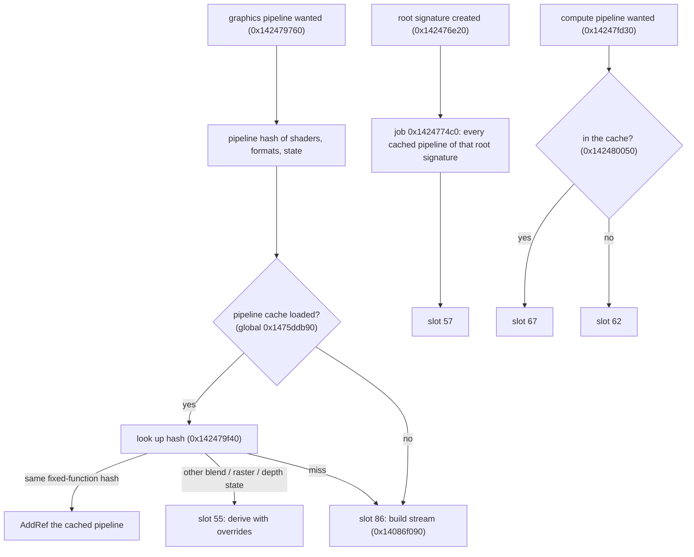
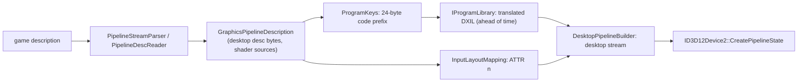

# D3D12.X pipeline creation

How the game creates pipeline states on the D3D12.X device and how the loader turns them into desktop
`ID3D12PipelineState` objects. Read from `game_scarlett_master.exe` (image base 0x140000000); slot numbers are device
vtable slots ([d3d12x-shim.md](d3d12x-shim.md)). Items marked *inferred* follow from how the game fills or uses a
value, not from a header. Code: `src/FiveStar.Loader/Shims/D3D12X/Pipelines`.

## The five slots

Every call passes `ID3D12PipelineState`'s IID (0x1461e06b8) and an out pointer last.

| Slot | Offset | Call site | Arguments after the device | Description |
|---|---|---|---|---|
| 55 | 0x1B8 | 0x14247a5c2 | base pipeline, u32 count, override array, IID, out | derive from a cached pipeline (below) |
| 57 | 0x1C8 | 0x142477578 | cache description (0x108 bytes), IID, out | graphics pipeline of the pipeline cache |
| 62 | 0x1F0 | 0x14247fe66 | `D3D12_COMPUTE_PIPELINE_STATE_DESC`, 0, 0, IID, out | compute pipeline; the two extra arguments are always 0 |
| 67 | 0x218 | 0x1424800d5 | cache description (0x48 bytes), IID, out | compute pipeline of the pipeline cache |
| 86 | 0x2B0 | 0x142479a87 | `D3D12_PIPELINE_STATE_STREAM_DESC`, IID, out | graphics pipeline from a stream (desktop `ID3D12Device2::CreatePipelineState`) |

Slot 101 (0x1424813ef, state-object IID) creates the ray-tracing state object and is not covered here.

A graphics result is stored at +0x38 of the game's pipeline object (and bit 7 of +0x1D set), a compute result at
+0x120. Cached pipelines are kept in the cache's hash map as `pointer >> 1` and AddRef'ed on every hit.

## Pipeline-state stream (slot 86)

0x14086f090 zeroes 0x2B0 bytes and writes a fixed stream; the desc is `{u64 0x2B0, stream}`. Each subobject is a u32
type, then its desktop payload, pointer-aligned as with the d3d12.h stream helpers.

| Offset | Type | Payload |
|---|---|---|
| 0x000 | 0 root signature | +0x08 pointer (the pipeline's root signature, +0x80 of its shader set) |
| 0x010 | 1 VS, or 24 mesh shader | +0x18 `D3D12_SHADER_BYTECODE` |
| 0x028 | 2 PS | +0x30 |
| 0x040 | 3 DS | +0x48 |
| 0x058 | 4 HS, or 23 amplification shader | +0x60 |
| 0x070 | 5 GS | +0x78 |
| 0x088 | 8 blend | +0x8C `D3D12_BLEND_DESC` copied from the blend-state table |
| 0x1D8 | 9 sample mask | 0xFFFFFFFF |
| 0x1E0 | 10 rasterizer | +0x1E4 `D3D12_RASTERIZER_DESC` |
| 0x210 | 21 depth-stencil 1 | +0x214 `D3D12_DEPTH_STENCIL_DESC1` |
| 0x250 | 17 sample desc | count `1 << table[n]`, quality from a table |
| 0x260 | 12 input layout | +0x268 `D3D12_INPUT_LAYOUT_DESC` (elements built by 0x14086fa70) |
| 0x278 | 14 primitive topology type | |
| 0x280 | 15 render-target formats | +0x284 eight formats, +0x2A4 count (one past the last non-zero) |
| 0x2A8 | 16 depth-stencil format | |

The vertex slot gets type 24 when the shader's flags (+0x50, bits 56 and 57) mark it as a mesh shader, and the hull
slot then type 23. On the desktop 24 is the amplification and 25 the mesh shader, so the console enum is one lower
for both (*inferred*). Every other value is the desktop one.

### Shader bytecode

The bytecode of every stage comes from 0x14086f8e0 and the game's shader object:

| Shader object | Meaning |
|---|---|
| +0x08 | loaded bytecode (0 until first use) |
| +0x18 | 64-bit shader hash (the root-signature key of the cache) |
| +0x20 | stored size |
| +0x30, +0x38, +0x40 | file, reader and offset of the stored bytes |
| +0x50 | flags |

When +0x08 is empty the stored bytes are read. If they start with the u16 0xDCE7 they are an SGD5 shader record from
its constant field on (`E7 DC 0D 00`, compressed size, decompressed size at +8) and are inflated
([shader-containers.md](shader-containers.md)). The bytecode is therefore the shader's DXBC container, whose XDAT
section holds the FSSM program.

## Compute desc (slot 62)

`D3D12_COMPUTE_PIPELINE_STATE_DESC` (0x38 bytes): root signature at 0 (+0x118 of the game's compute object), CS at 8
(a DXBC container, as above), NodeMask 1 at 0x18, no cached blob, no flags. The game releases the root signature when
the call fails.

## Pipeline cache (slots 57, 67)

The `PS 00 09` blob of shaders.rpf ([pipeline-cache.md](pipeline-cache.md)) is the game's `.d3d12PipelineCache`
(string at 0x14678331a). The object at 0x1475ddb90 (constructor 0x14248d9b0) holds the magic, two 32-byte strings
and a u64; the loader (0x14248e070) accepts a file whose header equals them at 0x00, 0x04, 0x24 and 0x48, then reads
the record tables, both indexes, the metadata area and the code area (into 256-byte aligned memory).

0x14248f680 turns each graphics record into a map node keyed by the record's u64 at 0x10 (the shader hash of the
root signature), holding record 0x00..0x37 and this description:

| Offset | Size | Field |
|---|---|---|
| 0x00 | 8 | root signature (set by the caller) |
| 0x08 | 16 | fixed-function state metadata {pointer, size} |
| 0x18 | 16 | input-layout metadata {pointer, size} |
| 0x28 | 7 × 32 | per record slot: {code pointer, code size, shader-metadata pointer, shader-metadata size}; zero when empty |

Compute records become a 0x48-byte description: root signature, state metadata, the record's 0x0C metadata, then one
slot as above at 0x28.

When a root signature is created for a shader hash, a job (0x1424772f0 → 0x1424774c0) creates every cached graphics
pipeline of that hash through slot 57 and enters it in a second map by the record's u64 at 0x00 (the pipeline hash).

The lookup 0x142479f40 compares the record's 0x18 with the wanted fixed-function hash; on a mismatch it compares
0x20, 0x28 and 0x30 with the hashes of the wanted depth-stencil, rasterizer and blend state and derives (slot 55).
So 0x18 is a hash of all fixed-function state and 0x20 / 0x28 / 0x30 hash the depth-stencil, rasterizer and blend
states (*inferred* from the comparisons).

### Derive (slot 55)

The override array has 0x14C-byte entries, a u32 kind then the desc:

| Kind | Desc |
|---|---|
| 0 | `D3D12_DEPTH_STENCIL_DESC` (write mask 0 when depth is off) |
| 1 | `D3D12_RASTERIZER_DESC` |
| 2 | `D3D12_BLEND_DESC` |
| 5 | written after kind 0 when the state asks for it: 16 zero bytes, the stencil read and write masks, 0; meaning unknown |

Each desc is built from the compact state tables with desktop enum values. Entries come in the order rasterizer,
depth-stencil (then 5), blend, each only when its hash differs.

### Topology type

The stream's topology type comes from the state's topology byte (+0x1E) through a table (0x1461edaac, 4 for bytes
above 20). The table yields 0 to 4 and 19 for byte 17. The command list's topology setter (0x140032570) passes
topologies 6 and 0x13 to the D3D12 interface as triangle lists, so 19 is a triangle-class type (*inferred*: a
rectangle list) and becomes `TRIANGLE`; so does 0.

## Translation

| Game item | Desktop pipeline |
|---|---|
| Shader (DXBC container or cache code block) | the translated program whose code block starts with the same 24 bytes (the FSSM program inside a container and the cache's code block share them); DXIL is read from the ahead-of-time translation, dxc never runs here |
| Shader stage | from the program's hardware stage: VS, PS, GS, NGG as mesh shader (no input assembler then) |
| Root signature | `BindlessRootSignature`, created once per device; the game's root signature is kept in the description for binding translation |
| Input layout | element n of a cache layout becomes `ATTR` n; a stream element becomes `ATTR` p, p its position among the non-system ISG1 inputs of the VS; elements the VS does not read become `UNUSED` k |
| Blend, rasterizer, depth-stencil, sample mask, formats, sample desc | passed through (stream); decoded from the context registers (cache) with 0 values replaced by the D3D12 default |
| Topology type | 1 to 4 pass; 0, the console type 19 and other values become `TRIANGLE` (stream and cache) |
| Depth format (cache) | not stored: D32_FLOAT, or D32_FLOAT_S8X24_UINT with stencil (*inferred*) |
| Derive | the base pipeline's description (kept per created pipeline) with the overrides applied, created anew |

`TranslatedProgramLibrary` reads DXIL from the output of `fivestar shader translate`, finding names through a
`ProgramIndex` of the extracted programs. A description that cannot be read is logged once and answered with
E_NOTIMPL; a shader without a translation with HRESULT_FROM_WIN32(ERROR_NOT_FOUND).

### Variant per adapter

When the translated folder holds `variants.json`, `ProgramVariantPicker` picks each program's file with
`VariantSelector` ([shader-translation.md](shader-translation.md#wave-size)) for the desktop device: shader model,
`WaveLaneCountMin`/`Max` (D3D12_OPTIONS1) and the mesh-shader tier (D3D12_OPTIONS7), read by `DesktopAdapter`.

| Selector result | File loaded |
|---|---|
| native | `<name>.dxil` |
| variant | `<name>.w32.dxil`: the group-wave or superstep form of a compute program pinned to a wave size outside Min-Max, or the superstep form of a mesh program whose floor is above `WaveLaneCountMin` |
| fallback (mesh program, no mesh shaders or over the output limit) | `<name>.dxil`, logged once: a pipeline takes one shader per stage, and the compute + vertex-pulling fallback needs its own draw path |
| incorrect, compute pinned without a variant | none, logged once with the adapter's wave range; creation returns ERROR_NOT_FOUND instead of a driver error |
| incorrect, other | `<name>.dxil`, logged once (results may differ from the console) |

Without `variants.json` every program loads `<name>.dxil` and a warning says so.

## Device hookup

When the device is created and the loader has `--shader-dir` and `--translated-dir`, `XboxDeviceFactory` builds the
`PipelineSlots` (a `PipelineFactory` over the desktop `ID3D12Device2`, `BindlessRoot.Create` and a
`TranslatedProgramLibrary`) and `PipelineSlotHandlers.Register` binds slots 55, 57, 62, 67 and 86 through
`XboxObjects.SetHandler`. Without the folders the slots stay logged E_NOTIMPL stubs. Pipeline states are returned
unwrapped, so slot 55 receives the desktop pointer it registered.

## Unknown

- Override kind 5, and whether kinds 3 and 4 exist.
- The meaning of the shader flags beyond the mesh bits, and of the second stored bytecode (+0x10, size +0x2C) that
  0x14086f8e0 reads when its last argument is set (the pipeline paths pass 0).
- Render-target formats of cache pipelines are the cache's guesses; the stream path carries the real ones.
- Running the mesh fallback (and linked VS forms) through pipelines, for adapters without mesh shaders.
- What console topology type 19 and topology 6 are exactly (rectangle list and triangle fan are guesses).
- Which pipelines' programs read graphics user SGPRs 0 to 7 as their own; the command list fills them with SGPRs 8
  to 15 for mesh programs ([d3d12x-shim.md](d3d12x-shim.md#binding)).
