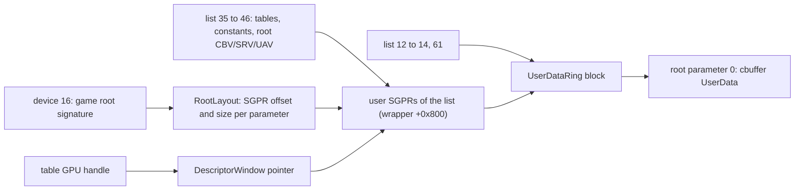

# D3D12.X device shim

The game imports three functions from `d3d12_xs.dll`: `D3D12XboxCreateDevice`, `D3D12ConfigureVirtualMemoryX` and
`D3D12SerializeVersionedRootSignature`. All other rendering goes through COM vtables on the device and the objects
it creates. This page lists what the game passes and calls, read from `game_scarlett_master.exe` (addresses at image
base 0x140000000), and how the loader shims it. Field and method names marked *inferred* come from argument shapes,
not from the GDK header: the PC GDK (`Microsoft GDK\261000`) ships only `windows\include` headers, none for
D3D12.X.

## Startup order

The device is created in one function (0x142478440), after the game registers and shows its own Win32 window
(`RegisterClassExA`, `CreateWindowExA`, `ShowWindow`):

1. `D3D12ConfigureVirtualMemoryX` (call at 0x141e1cfe0), then `XMemVirtualAlloc` reserves the GPU virtual range.
2. `D3D12XboxCreateDevice` (call at 0x1424785b7). The device pointer goes to 0x1475df048 and is copied to eleven
   more globals (0x1475deff8 to 0x1475df040, 0x148759d00).
3. On an OS build of 10.0.26100.9628 or later: device slot 49 with (0x11F, 1).
4. Slot 26 (GetCustomHeapProperties) for heap types 1, 2, 3; slot 8 (CreateCommandQueue) for one direct queue
   (stored at 0x148759ff8); slot 48 four times for four more queues (0x1475e7038 to 0x1475e7050).
5. Slot 9 and slot 73 create command allocators and lists; the lists record X-only slots 132 and 131 and are closed
   (slot 9).

## D3D12XboxCreateDevice

`HRESULT D3D12XboxCreateDevice(IGraphicsUnknown* adapter, const D3D12XBOX_CREATE_DEVICE_PARAMETERS* parameters,
REFIID riid, void** device)`. The game passes a null adapter and `riid` = `5405c344-d457-444e-b4dd-2366e45aee39`,
the desktop IID of ID3D12Device11 (`XboxBvhBuilder.dll` also takes an `ID3D12Device11*`).

The parameter block is 0x50 bytes, cleared before it is filled:

| Offset | Value | Meaning |
|---|---|---|
| 0x00 | 0x00020004 | Version (*inferred*) |
| 0x04 | 0 | Process debug flags (*inferred*) |
| 0x08 | 0x00100000 (1 MiB) | Graphics command-queue ring size (*inferred*) |
| 0x0C, 0x10 | 0 | Graphics and compute scratch sizes, 0 = default (*inferred*) |
| 0x20 | byte at 0x14a943957 | Boolean set at run time; meaning unknown |
| 0x24 | byte at 0x14a943958 | Boolean set at run time; meaning unknown |
| 0x28 | 1 | Unknown |
| 0x3C | 0x20 | Unknown |
| other | 0 | |

## D3D12ConfigureVirtualMemoryX

One pointer to a 32-byte block, zero except the dword at +4: `ceil(size / 16 GiB) + 2`, where `size` is 16 GiB when
the console-type query (0x1455deb88) returns 6 and 24 GiB otherwise. The same `size` is then reserved with
`XMemVirtualAlloc`. A failing HRESULT hits an `int3`.

## Calling convention

- Device methods that return a struct take the return buffer in rcx and the object in rdx (slot 25 at 0x14034413f,
  slot 26 at 0x14247870d, slot 108 at 0x140abfe07). The desktop ABI is the other way round. Resource GetDesc (slot
  10) uses the desktop order (object in rcx, call at 0x14501f80b).
- AddRef and Release are ordinary vtable calls (slots 1 and 2); the game does not touch reference counts directly.

## Vtable census

A static scan of every function in `.pdata` (scratch tooling, not in the repository) follows the device from its
globals, through function parameters and return values, and types each created object by the IID passed next to
its out-pointer. The counts are call sites, not run-time frequency; objects reached only through engine structures
are under-counted.

### Device (85 sites, 42 slots)

Slots 0 to 43 follow desktop ID3D12Device order: every creation slot below passes the IID of the desktop object it
should create. From slot 44 on the order is not desktop's.

| Slot | Offset | Sites | Method | Evidence |
|---|---|---|---|---|
| 0 | 0x000 | 1 | QueryInterface | asks for IDXGIDevice |
| 2 | 0x010 | 2 | Release | |
| 8 | 0x040 | 2 | CreateCommandQueue | queue IID |
| 9 | 0x048 | 5 | CreateCommandAllocator | allocator IID |
| 14 | 0x070 | 3 | CreateDescriptorHeap | descriptor-heap IID |
| 15 | 0x078 | 10 | GetDescriptorHandleIncrementSize | |
| 16 to 21 | 0x080-0x0A8 | 1 each | CreateRootSignature, CreateConstantBufferView ... CreateDepthStencilView | |
| 24 | 0x0C0 | 1 | CopyDescriptorsSimple | (1, dest, src, type) |
| 25 | 0x0C8 | 3 | GetResourceAllocationInfo | struct return, swapped registers |
| 26 | 0x0D0 | 3 | GetCustomHeapProperties | struct return, swapped registers |
| 27 | 0x0D8 | 1 | CreateCommittedResource | resource IID |
| 36 | 0x120 | 1 | CreateFence | fence IID |
| 39 | 0x138 | 1 | CreateQueryHeap | query-heap IID |
| 41 | 0x148 | 5 | CreateCommandSignature | command-signature IID |
| 48 | 0x180 | 4 | X: create command queue | queue IID, desc, IID, out |
| 49, 50 | 0x188, 0x190 | 1 each | X | |
| 55, 57, 62, 67, 86 | | 1 each | X: create pipeline state (five variants, [d3d12x-pipelines.md](d3d12x-pipelines.md)) | pipeline-state IID |
| 61 | 0x1E8 | 1 | X: create sampler (*inferred*) | (0x6c-byte desc, CPU handle), desc filled at 0x1412b96b0; the game then flushes the descriptor (0x1412b9800) |
| 70 | 0x230 | 6 | X: create SRV without a resource object (*inferred*) | (D3D12_RESOURCE_DESC, 64-byte view desc: desktop SRV desc + GPU address at +0x28, CPU handle) (0x144ecc800) |
| 71 | 0x238 | 2 | X | |
| 73 | 0x248 | 3 | X: create command list | (16-byte desc, allocator, PSO, IID, out) |
| 74 | 0x250 | 1 | X: register a mapped range (*inferred*) | (address, 0x185c0 pages, 8-byte out) after mapping the streaming range (0x141e6c2bb) |
| 78 | 0x270 | 1 | X: SetFrameIntervalX (*inferred*) | (null, interval µs, period, 0) ([Present](#present)) |
| 79 | 0x278 | 3 | X: ScheduleFrameEventX (*inferred*) | (type, offset µs, null, 0) |
| 80 | 0x280 | 3 | X: WaitFrameEventX (*inferred*) | (type, timeout, null, flags, UINT64* token in/out) |
| 81 | | 1 | X | |
| 101 | 0x328 | 1 | X: create state object | state-object IID |
| 108 | 0x360 | 1 | X: GetResourceAllocationInfo1 (*inferred*) | struct return, mask, count, descs, per-desc infos |
| 119, 132 | | 1-2 each | X | |
| 127 | 0x3F8 | 1 | X: create committed resource (*inferred*) | CreateCommittedResource3 arguments: initial barrier layout, no castable formats (0x14193e1b4) |
| 133 | 0x428 | 3 | X: create resource at a GPU address (*inferred*) | (address, desc, initial barrier layout, clear, resource IID, out) |

### Command queue

The queue's own methods sit two slots later than on the desktop: GetTimestampFrequency is slot 18 (one
`UINT64*`), Signal slot 16 (fence, value). The shift is the queue's, not ID3D12Pageable's: the descriptor heap,
also pageable, has GetCPUDescriptorHandleForHeapStart at desktop slot 9 (call at 0x141c74559).

| Slot | Offset | Sites | Method |
|---|---|---|---|
| 16 | 0x080 | 1 | Signal (*inferred*) |
| 18 | 0x090 | 1 | GetTimestampFrequency (*inferred*) |
| 23 | 0x0B8 | 1 | X: suspend, argument 0 (*inferred*: process-lifetime suspend) |
| 24 | 0x0C0 | 1 | X: resume (*inferred*) |
| 31 | 0x0F8 | 1 | X: page mappings (*inferred*), not presenting: (count, range array, object, dword, 0) on another queue (global 0x1471bfce8), after the game maps 64 KiB pages itself (0x140f2cc7f) |
| 32 | 0x100 | 2 | X: PresentX (*inferred*), [Present](#present) |
| 35 | 0x118 | 2 | X: execute command lists (*inferred*): (count, lists, object from a global, flags 0 or 3) |

The per-frame submit is 0x142481e90: slot 35 (up to 256 lists), then slot 32, with device slot 80 called between
frames ([Present](#present)).

### Command list

The game asks slot 73 for desktop ID3D12GraphicsCommandList (`5b160d0f-...`) in one place and for
`c3827890-4024-474c-98cf-645b51dc4874`, not a desktop IID, in the others. Close is slot 9 as on the desktop.
Slots 131 and 132 (X-only) take (register offset, value, 0, mask 0xFFFFFFFFFF00): register writes.

Most commands are recorded inline: the game compares the list's write pointer (+0x18) with a limit (+0x28 before
draws, +0x30 otherwise), writes PM4 packets itself when there is room, and calls the vtable slot only when there is
not. It also writes state into the list object (+0x140, +0x544 to +0x563) and reads +0x548 and a register table
at +0x144 / +0x344. The 34 functions that load the list from the graphics context (+0x127C8) call these slots; the
method follows from the arguments and from the inline packet written instead:

| Slot | Desktop | Method | Evidence |
|---|---|---|---|
| 9 | 9 | Close | creation code |
| 12, 13 | 12, 13 | DrawInstanced, DrawIndexedInstanced | 4 and 5 counts; limit +0x28 |
| 20 to 24 | 20 to 24 | IASetPrimitiveTopology ([Boot](#boot)), RSSetViewports, RSSetScissorRects, OMSetBlendFactor, OMSetStencilRef | (1, rects), float*, one dword |
| 25 | 25 | SetPipelineState | PSO; caches PSO state at +0x544 |
| 29, 30 | | X | (pointer, dword, dword) at 0x142482b99; 30 has 7 arguments (0x1424843b0); not reached in boot |
| 32 | 28 | SetDescriptorHeaps | (2, {main view heap, sampler heap}) at 0x144e4cac2, when a context takes a new list |
| 33, 34 | 29, 30 | SetCompute/GraphicsRootSignature | root signature from the PSO (+0x80) |
| 35, 36 | 31, 32 | SetCompute/GraphicsRootDescriptorTable | (index, GPU handle); inline dword + low dword |
| 37, 38 | 33, 34 | SetCompute/GraphicsRoot32BitConstant (*inferred*: between 36 and 39) | |
| 39, 40 | 35, 36 | SetCompute/GraphicsRoot32BitConstants | (index, count, data, 0) |
| 41, 42 | 37, 38 | SetCompute/Graphics root CBV (*inferred*: between 40 and 43) | |
| 43 to 46 | 39 to 42 | SetCompute/Graphics root SRV and UAV | (index, GPU address); inline dword + qword |
| 47, 48 | 43, 44 | IASetIndexBuffer, IASetVertexBuffers | view* or null; (0, count, views) |
| 50 | 46 | OMSetRenderTargets | (count, handles, FALSE, DSV*) |
| 51, 52 | 47, 48 | ClearDepthStencilView (*inferred*), ClearRenderTargetView | (handle, color*, 0, null) |
| 61 | 59 | ExecuteIndirect | (signature, 1, argument buffer, offset, null, 0); 8 sites |
| 62 | | X | (pointer, pointer, dword, 0) |
| 70 | 62 | OMSetDepthBounds | floats in xmm1, xmm2 |
| 72, 75, 126 to 128, 142 | | X | one site each |

Slots 32 to 52 are the desktop slot + 4, so ResourceBarrier and ExecuteBundle are among slots 26 to 31 with X slots
(*inferred*; none of 26 to 31 is called in boot); between 52 and 61 two desktop methods are missing. The inline form
of a descriptor table is (dword from the root signature's register table at list +0x144 + index * 4, low dword of the
GPU handle): the table reaches the program as a 32-bit address in one user SGPR. The game derives a GPU handle as its
CPU handle + (GPU start - CPU start) (0x1400321d8; heap record at 0x1475e7378: +0x18 heap, +0x20 CPU start, +0x30
increment, +0x38 GPU start - CPU start).

### Descriptor heaps

The game allocates CPU descriptor memory the console way: D3D12.X takes it from the title's `XMemAlloc` hook (the
exe exports `__XMemAllocationHooks__`). Around the creation of the main shader-visible heap (0x141cf3280, 1245184
descriptors) the game pushes a hook that answers allocator id 128, object type 4 with memory it reserved, and breaks
into the debugger unless slot 9 then returns that memory.

The game treats that memory as plain memory, 32 bytes per descriptor (measured at boot):

| Descriptors | Bytes | Use |
|---|---|---|
| 0 to 327,679 | 0 to 0x9FFFFF | persistent views, written through slots 17 to 24 and 70; free list in dword 0 of each free descriptor (next free index, last 0xFFFFFFFF), filled by the game before the first view; boot writes 0 to 10 and 17 to 101 |
| 360,448 on | 0xB00000 on | the start of the 0xAE00000-byte slot-133 pool, which overlaps the heap's last 0x1B00000 bytes |

Per-draw tables are not written through the device: 0x1400321d8 takes room from the graphics context's linear
allocator (0x142484aa0: count × increment bytes), 0x144d9efc0 copies each 32-byte descriptor into it with AVX moves
from the persistent descriptor its binding names (record +0x18), and the table's GPU handle is that address + (GPU
start - CPU start). Boot binds such tables at descriptors 368,373 to 372,600, in pool memory next to other data
(vertex positions).

## Shim

`XboxDeviceFactory` (`src/FiveStar.Loader/Shims/D3D12X`) implements `D3D12XboxCreateDevice` on a desktop
ID3D12Device (default adapter, feature level 12_1). `D3D12ConfigureVirtualMemoryX` logs its argument and returns
S_OK.

### Wrappers

Every object the game gets is a wrapper (`XboxObjects`): a pointer to the D3D12.X vtable, then the desktop object at
+8. One native block holds a vtable per interface (`XboxInterfaceKind`), so a pointer whose vtable lies in it is a
wrapper.

- Slots listed in `XboxInterfaces` are generated tail-call thunks: `mov rcx,[rcx+8]; mov rax,[rcx]; jmp
  [rax+desktop*8]`, with the slot remapped; struct-returning slots load the object from rdx and swap rcx and rdx.
  Arguments in rdx, r8 or r9 that may carry a wrapper are unwrapped first (`test; jz; mov r10,[reg]; range check;
  mov reg,[reg+8]`), any other pointer passes through. No managed code runs on these calls.
- Every other slot is a stub that logs its first call as `d3d12_xs.dll!<interface>.X::SlotN` with the caller and
  returns E_NOTIMPL.
- QueryInterface returns the wrapper when the desktop answer is the object itself, Release frees the wrapper with
  the desktop object, GetDevice returns the device wrapper.
- `XboxObjects.SetHandler(kind, slot, handler)` binds any slot to a native function (an `[UnmanagedCallersOnly]`
  method taking the wrapper first), before or after the vtables exist. `Wrap`, `Unwrap` and `WrapResult` are the
  helpers for handlers that create or receive objects.
- Pipeline states (slots 55, 57, 62, 67, 86, [d3d12x-pipelines.md](d3d12x-pipelines.md)) are returned unwrapped.

| Interface | Forwarded slots | Slot map |
|---|---|---|
| Device | 1 to 43 | desktop order; 25, 26, 43 swap; views (18 to 21), 31, 42 unwrap |
| Command queue | 13 to 20 | desktop slot + 2; Signal and Wait unwrap the fence; 20 (GetDesc) swaps |
| Command allocator | 8 | desktop (*inferred*) |
| Command list | 8 to 25, 50 to 52, 70 | as in the table above; 139 is Reset with a third argument (0x142474cce); Reset, ClearState, copies and SetPipelineState unwrap |
| Resource | 8 to 14 | desktop |
| Heap, descriptor heap | 8 | GetDesc, swaps |
| Fence | 8 to 10 | desktop (*inferred*); 12 is a handler |
| Query heap, command signature | none past the base slots | |

The command-list wrapper is 4 KiB and zeroed: write pointer and limits stay 0, so every inline command calls its
slot. Reset (10, 139), draws and dispatches (12 to 14, 61) and slots 32 to 46 are binding handlers
([Binding](#binding)); 47 and 48 (index and vertex buffers) stay stubs until console addresses are translated.

### Handlers

| Interface | Slot | Handler |
|---|---|---|
| Device | 8, 9, 12, 14, 27 to 30, 36, 39, 41 | desktop creation, result wrapped; wrapped heap, allocator and PSO arguments unwrapped; resource descs made desktop ones (below); in command signatures the X-only argument type 0x69 (12 bytes, built next to a DISPATCH one) becomes DISPATCH |
| Device | 25, 38, 108 | allocation info (108 through ID3D12Device4::GetResourceAllocationInfo1) and footprints on desktop descs; the game breaks into the debugger when a size does not fit 32 bits (0x140344196) |
| Device | 17 to 24 | view creation and descriptor copies with CPU handles translated (below) |
| Device | 34, 35 | MakeResident, Evict: S_OK (desktop objects are resident from creation) |
| Device | 48, 73 | compute queues (flags reduced to DISABLE_GPU_TIMEOUT) and command lists, wrapped |
| Device | 61, 70 | the desktop sampler of the console sampler desc, and an SRV on the desktop texture at the view's address ([gpu-resources.md](gpu-resources.md)) |
| Device | 74 | logged, output zeroed, S_OK |
| Device | 127 | committed resource (below) |
| Device | 78 to 80 | frame interval, frame events and their wait on a timer ([Present](#present)) |
| Device | 133 | buffer at a game address (below), or a texture registered by address ([gpu-resources.md](gpu-resources.md)) |
| Command queue | 12, 35 | unwrap up to 256 lists per call and run desktop ExecuteCommandLists; 35 ignores its frame object and flags |
| Command queue | 32 | present on a swap chain ([Present](#present)) |
| Resource | 2 | Release that also frees a slot-127 resource's title memory |
| Resource | 11 | the console address for a slot-133 resource, else the desktop GPU address |
| Fence | 2, 12 | 12 returns a cell holding the completed value, which the game polls (0x144fb0ad0); a mirror thread keeps every such cell current (SetEventOnCompletion(value + 1) on a shared event) |
| Descriptor heap | 9, 10 | heap start handles returned in rax; for the game's shader-visible view and sampler heaps both return the title memory ([Binding](#binding)) |
| Device | 16 | CreateRootSignature; the parameter layout is kept ([Binding](#binding)) |
| Command list | 10, 12 to 14, 32 to 46, 61, 139 | [Binding](#binding) |
| Command list | 20 | IASetPrimitiveTopology with console topologies made desktop ones ([Boot](#boot)) |

### Game memory on the GPU

Slot 133 (GPU address, buffer desc, 0xFFFFFFFF, null clear value, IID, out) asks for a buffer over XMem pages the
game mapped itself (`XboxPlacedResources`). The store's whole-section view of each page section
([physical-memory.md](physical-memory.md)) is opened with `ID3D12Device3::OpenExistingHeapFromAddress`
(`OpenExistingHeapFromFileMapping` rejects the pagefile sections with E_INVALIDARG). The range is split into runs of
pages contiguous in one section; each run becomes a buffer placed at its section offset, with
ALLOW_CROSS_ADAPTER (required on such heaps) and the game's flags reduced to UNORDERED_ACCESS (it passes 0x20004).
The game's resource is the first run's buffer; GetGPUVirtualAddress returns the console address; every run's
console range and desktop GPU address go into `XboxPlacedResources.Addresses`, the translation the command-list
and descriptor work will use (on the console GPU address == CPU address). UpdateTileMappings does not take these
(cross-adapter) heaps, so one resource cannot span sections; the page store therefore gives a multi-page allocation
consecutive pages of one section, in the address order of the placeholder it is mapped into
([physical-memory.md](physical-memory.md)). The game's 0xAE00000-byte pool (three pieces of one placeholder, mapped
later piece first) is one run and one buffer. A range with no mapped page gets a committed buffer that is not shared.
A texture at a game address becomes a committed desktop texture of its own, filled from the game's bytes unless the
GPU writes it ([gpu-resources.md](gpu-resources.md)).

Memory the game commits itself (XMemVirtualAlloc with MEM_COMMIT, such as the 2.2 GiB heap with PAGE_GRAPHICS_*
protection) is GPU memory on the console too. The first console GPU address there that the table misses opens the
whole VirtualAlloc allocation as a heap (OpenExistingHeapFromAddress) with one placed buffer over it
(`XboxGameMemoryBuffers`). CBVs (slot 17) translate their address this way and grow to 256 bytes; an address
outside known memory or off the desktop's 256-byte alignment (the console takes 16) gets a null CBV, logged once.

**Resource descs.** Before the desktop sees one: flag bits above 0x1FF dropped (0x20000 on GPU-memory buffers,
0x300000 on textures), a console layout (0x100 + XG swizzle mode, set at 0x1403440f7) made UNKNOWN, and
ALLOW_UNORDERED_ACCESS dropped from textures whose format has no typed UAV store, or that the runtime refuses
anyway (B5G5R5A1_UNORM: the refused allocation-info query runs again without the flag).

**Committed resources (slot 127).** Created in the state of the initial barrier layout (buffers COMMON), heap flags
0 (the game passes 8). On the console D3D12.X takes their memory from the title's XMemAlloc hook, and the game checks
it: around its two 4K render targets (0x14247ad10) it pushes a hook for D3D allocations with page-size field 2 that
hands out a 64 MiB region, and breaks into the debugger unless all but 2 MiB of it was used. The shim allocates the
desktop size with attributes 0x11808000 (allocator 128, page size 2, 64 KiB alignment) and frees it with the resource.

**Root signatures.** `D3D12SerializeVersionedRootSignature` drops the flag bits above 0xFFF (`XboxBvhBuilder.dll`
passes 0x3000000) and logs the serializer's message when it still fails.

**XboxBvhBuilder.dll.** Its constructor builds compute pipelines from console shader code (device slot 62) and
throws when that fails. Its seven exports bind to shims: prebuild sizes from the desktop's
GetRaytracingAccelerationStructurePrebuildInfo, builds, copies and rehydration logged once and skipped. With
`--raytracing` the DLL's own CPU paths give console sizes and rehydrate BLASes ([raytracing.md](raytracing.md)).

### Binding

Every list runs `BindlessRootSignature` (the one the pipelines use); the game's root arguments become the user data
of the translated programs (`Shims/D3D12X/Binding`).

- **Heaps** (`XboxDescriptorHeaps`, `ShaderVisibleHeap`). The game's shader-visible view and sampler heaps take
  title memory from the game's hook (allocator id 128, object type 4; pinned memory of the shim's own without a game
  image). Slots 9 and 10 both return it, so a CPU or GPU handle is the address of the descriptor's 32-byte record,
  as on the console. A record's dword 0 is the desktop index standing behind the descriptor, the rest zero: slots
  17 to 22, 61 and 70 write it with the view, so the game's own copies of records (its per-draw tables) carry
  desktop indices. The desktop view heap holds 7 reserved descriptors then whole 4096-descriptor pages up to
  1,000,000 (the tier-2 limit): 0 is a raw SRV over the descriptor window (`GPU_MEM_HEAP`), 1 a raw UAV over it, 2
  to 5 null descriptors for the mesh fallback table (root parameter 1; 5 is also what a record naming nothing
  reads), 6 a sink.
- **Remap** (`DescriptorRemap`). The game's 1,245,184 view descriptors fall into 304 pages; a page gets the next
  of the 244 desktop pages the first time a view is written in it (a lock only then; lookups read an array), and
  stays contiguous inside. Boot touches one page. Only views written past all 244 pages land in the sink (warned
  once). The sampler heap gets 2048 samplers (the game asks for 128), game index = desktop index; 2032 to 2047
  (`STATIC_SAMPLER_BASE`) hold a trilinear wrapping sampler for the programs' literal S#s.
- **Copies (23, 24)** walk the ranges in runs both sides share. Inside one shader-visible heap they copy records;
  into one from a CPU-only heap, a desktop copy per desktop run with the records written; out of one, a desktop copy
  of what each record names.
- **SetDescriptorHeaps (32)** binds the desktop heaps behind the wrappers. A root signature set before any heap
  binds the main heaps first; a heap change sets the bindless root signature again.
- **Root signatures (16, 33, 34).** Device slot 16 reads the RTS0 part of the blob into a `RootLayout`: parameters
  packed into user SGPRs in order, a table one, root constants one per value, a root CBV/SRV/UAV two, from s8 for
  graphics and s4 for compute ([pipeline-cache.md](pipeline-cache.md#bindings)). List slots 33 and 34 keep the
  layout and set the bindless root signature and the fallback table.
- **Root arguments (35 to 46)** write user SGPRs: a table its window pointer, constants their values, a root
  descriptor the console GPU address as passed. Graphics SGPRs 8 to 15 are also written to dwords 0 to 7, where mesh
  and geometry programs read them (`user_sgpr(n - 8)`).
- **Draws and dispatches (12 to 14, 61)** upload the bind point's 128 dwords when they changed (a 64 MiB upload ring
  of 512-byte blocks, a block reused after 131,072 others) and point root parameter 0 at them; ExecuteIndirect
  unwraps its signature and buffers. Reset (10, 139) clears the list's binding state.
- **Descriptor window.** A buffer (custom heap, write-combined system memory, UAV; 0x2610000 bytes for the game):
  one 16-byte record per sampler, a 1024-record null table at 0x8000, then from 0x10000 one 32-byte record per game
  view descriptor in game order (a T#; buffers and CBVs use the first 16 bytes). Dword 0 of each mirrors dword 0 of
  the title record, a record naming no desktop descriptor reading 5. A table's user SGPR is the window offset of its
  first record (base + (handle - title start) / increment × record size), so a program's `MemLoad(table + k * 32)`
  reads the heap index of the table's k-th descriptor wherever the game put the table. Records are mirrored when the
  shim writes them and, for a table, at SetRootDescriptorTable: as many as the root signature's table spans (end of
  its last range, at most 1024, unbounded ranges 1024), skipping records whose dword 0 did not change (a shadow
  array). A handle outside both heaps reads the null table (warned once).

The window covers only descriptors of the console's 32-bit pointer space: pointers into game memory (root
descriptors, constants loaded through pointers) read the window, not game memory. Buffer views stay typed or
structured desktop views, while programs read every V# as a `ByteAddressBuffer`; V# dwords 1 and 3 (stride, format
code) stay 0.

### Present

**Frame pacing (device 78 to 80).** At device creation (0x142478dc2) and whenever a present record carries another
frame-rate setting (0x142482780), 0x14247ab10 picks a refresh divider (refresh rate / target rate, 1 to 4) and
calls slot 78 with the interval from a table at 0x1461ece60 (16667, 16667, 33333, 50000, 66667 µs at 60 Hz;
8333, 8333, 16667, 25000, 33333 at 120 Hz) and period 3 (2 in one mode), then slot 79 (type 0, offset). Device
creation also schedules type 2 at offset 0 (0x142478de4). Boot logs interval 33333 µs, period 3: 30 frames per
second at 60 Hz. Slot 80 is called three ways:

| Site | Arguments | Use (*inferred*) |
|---|---|---|
| 0x142484637 | (0, INFINITE, null, 0, &token = 0) | the main loop waits for the next frame origin and gets its token; only in the vsync-locked mode, else the token is 0 |
| 0x142482448 | (0, 0, null, 2, &global 0x1475e0e88) | the render thread takes the current token without waiting, when its record has none |
| 0x142482405 | (2, INFINITE, null, 0, &token of that frame) | before a present, wait for event 2 of the frame's token (from a 16-entry table at 0x1475de4b0) |

The token (global 0x1475e0e88) is the frame object queue slot 35 gets as its third argument and every plane's
first field.

**PresentX (queue 32).** (plane count, planes, parameters) from the render thread's record (type byte 2; the game
breaks on a failing HRESULT, 0x144e9b660). A record holds up to two plane entries of 0x18 bytes (resource, dword,
width, height) and builds one 0x48-byte plane each:

| Offset | Value | Meaning (*inferred*) |
|---|---|---|
| 0x00 | frame token | the slot-80 token |
| 0x08 | 1 | resource count |
| 0x10 | pointer to the entry's resource | ID3D12Resource* const* |
| 0x18 | RECT {0, 0, width, height} | source rect |
| 0x20 | float[4] {0, 0, 1, 1} (0x146159cd0) | normalized destination rect |
| 0x28 | the entry's dword | color space; 0 at boot |
| 0x2C to 0x47 | 0 | |

The parameter block is 0x20 bytes, zero except the dword at +0x18 = (record byte +0x3E == 0); all zero at boot.
Count 0 (0x14248b68a at shutdown, 0x14248d847 before the game releases and recreates its render targets) shows
nothing. Boot presents one plane: the 3840x2160 render target from slot 127 (R8G8B8A8 family), color-space dword 0.

**Shim.** `Shims/D3D12X/Present`:

- Slot 32 (`Presenter`) creates at the first present a flip-model swap chain (FLIP_DISCARD, 3 buffers, frame-latency
  waitable object, latency 2, SCALING_STRETCH, Alt+Enter off) on the presenting desktop queue and the game's window:
  the largest visible top-level window of the process that is not the console (the game's own, titled by the game).
  The buffers take the plane's source-rect size and the flip-model format of its typeless family (R8G8B8A8,
  B8G8R8A8, R10G10B10A2, R16G16B16A16); DXGI stretches them to the window, so window resizes need nothing, and a new
  plane size or format resizes the buffers after the GPU is idle. A minimized window skips the present.
- Each present waits for the latency object, copies the source rect of plane 0 into the back buffer
  (CopyTextureRegion, the plane RENDER_TARGET to COPY_SOURCE and back, which is the state the debug layer tracks
  for it at present; the back buffer PRESENT to COPY_DEST and back), runs the list on the presenting queue and
  presents with sync interval 1. One allocator per back buffer, retired by a fence; nothing is allocated per frame.
  A second plane is not composed.
- Color space: FP16 gets scRGB, R10G10B10A2 with dword 12 (HDR10 as a DXGI_COLOR_SPACE_TYPE) gets HDR10, otherwise
  sRGB; set with SetColorSpace1 when the display path supports it.
- `--present-test` draws eight color bars and a block that moves one step per present instead of the plane (also
  used for a plane format no flip-model format shares, or MSAA).
- Device 78 to 80 (`FramePacer`): origins every interval from the last interval change, token k at origin k; event
  type t at origin + its slot-79 offset. A type-0 wait with flag 2 or timeout 0 returns the current token at once, a
  blocking type-0 wait sleeps (high-resolution waitable timer) until the next origin and returns its token, a wait
  for another type with a token returns once that frame's event passed. A finite timeout that ends first returns
  HRESULT_FROM_WIN32(WAIT_TIMEOUT).

The log gets the first plane and parameter block, the swap chain, the first eight presents and the mean interval
every 600 presents and at exit.

### Debug layer

`--d3d12-debug` turns on the D3D12 debug layer before the device is created (`--d3d12-gpu-validation` adds
GPU-based validation) and DRED auto-breadcrumbs and page-fault reporting. The debug layer needs the Graphics Tools
optional feature (`d3d12SDKLayers.dll`); without it a warning says so and only DRED is on. Info-queue messages go to
the log through ID3D12InfoQueue1::RegisterMessageCallback on the thread that caused them: errors and corruption
with the mapped frames that made the call, warnings as warnings, the rest as details. Without the callback the
stored messages are drained after a failed creation. A private fence waiting for UINT64_MAX notices device
removal when it happens; the removal reason, the stored messages and the DRED breadcrumbs and page-fault
allocations are then logged once.

Two bisection aids: `--d3d12-skip list:20,queue:35` makes the named slots do nothing and return 0 (whatever handler
is bound before or after), and `--d3d12-trace-queues` logs the first 4000 submissions (with the X frame object and
flags), queue Signal and Wait and CPU fence signals, numbering queues and fences as they appear. Without
`--shader-dir` the boot reaches the first frames in about 15 s, which makes a run per bisection step cheap.

### Boot

The device removal after the descriptor heaps was a CreateUnorderedAccessView (call from 0x141647616): a raw
R32_TYPELESS view over the whole 0xAE00000-byte slot-133 pool, on the first of four placed buffers (0x1B00000
bytes). With the pool in one buffer, boot passed, in order: GetResourceAllocationInfo with console flags and layouts
(0x140344196), the render-target budget (slot 127, 0x14247af2d), root-signature flags in XboxBvhBuilder.dll, its
console compute pipelines, command-signature argument type 0x69, slot 74 (0x141e6c2c5), slot 108 (0x140abfe1b),
slot-133 textures, list slot 139 (0x142474ce1), resource GetDesc register order, the first ExecuteCommandLists,
WaitFrameEventX (device 80) and the first present (queue 32: the game's window shows the plane, black so far, or
the test pattern), then texture formats refused as UAVs, fence slot 12 (0x144fb0b03) and unaligned CBVs.

**The GPU hang after the first frame** (DXGI_ERROR_DEVICE_HUNG; every list submitted after it stopped before its
first command, DRED page fault at VA 0, the game then broke at 0x142474606, its device-removed handler behind the
fence wait 0x144fb0e29) was IASetPrimitiveTopology (list slot 20) forwarding the console value 17. The desktop
runtime and debug layer do not check the value; the GPU hangs when the next list starts. The queue trace showed a
plain protocol: all work on the direct queue, (1 list, flags 0; 2 lists, flags 3) per frame, one Signal before and
one after each present, no queue Wait, and the compute queues of slot 48 unused in boot. Bisection without
pipelines: the hang stayed with present, clears, draws and binding skipped and went with slot 20 skipped. The
game's inline form of the call (0x140032570) maps topologies 6 and 0x13 to 4 itself and writes the rest through a
table to the hardware primitive type (0x1461ecf30: 17 -> 0x11, the rectangle list). The handler
(`PrimitiveTopologies`) sets 17 as a triangle list (the three vertices then cover half the rectangle) and drops any
other value the desktop does not define, warned once. With the GDK ABI table loaded, a 120 s boot with pipelines
presents about 25,000 frames (4.2 ms apart, the display's refresh with sync interval 1, not the 33 ms the game
asks device 78 for); the window stays black.

Barriers stay no-ops: the fix needs none. The debug layer still reports ClearRenderTargetView on the slot-127
render targets, which are created in UNORDERED_ACCESS (the initial layout the game passes); no list slot 26 to 31
is called in boot, so the game's barriers are not found yet.

The debug layer also reports error #553 about once per 500 presents: the list the present path submits from the
table at 0x1475e7300 (0x142482660; recorded once at device creation) runs again while its previous submission is still
executing, which the console allows and the desktop does not (the debug layer drops that submission). Waiting on the
CPU for the previous run before the resubmission removed the error but made the process fail in coreclr (access
violation at coreclr+0x165f05) within 3,000 presents, the same failure as a boot with queue slot 35 skipped, so it is
not done yet.

## Unknown

- Device slot 71; what slot 74's output is; whether list slot 139's third argument is flags. The open points of
  slots 61, 70 and 133 are in [gpu-resources.md](gpu-resources.md).
- CBVs at addresses the desktop cannot express (16-byte aligned); the allocator's slot 9 (callback, context).
- List slots 26 to 31, 53 to 60, 62 and above 70; the list slots that take wrapped resources inside structures
  (barriers, texture copies) and GPU addresses.
- Whether root constants take one SGPR per value (they are always the last parameter, so the metadata cannot tell),
  and what graphics s0 to s7 and compute s0 to s3 hold.
- Device slots 44 to 133 apart from those named above; the meaning of the desc dwords of slots 48 and 73.
- The slot maps marked *inferred*: allocator, resource and fence have no X call site in the census.
- Present: what the plane dword at +0x28 and the parameter dword at +0x18 mean, how a second plane is placed and
  blended, which flags slot 80's flag 2 and slot 78's period stand for, and the layout the console expects the plane
  in; queue slot 31's arguments.
- Which descriptors the game uses past boot (boot ends at the GPU hang); whether it reads fields of a descriptor
  back from title memory (it finds the shim's record there, not a T#); whether the console's view increment is 32
  bytes (the shim forwards the desktop's, 32 on the machine measured; the table copy at 0x144d9efc0 assumes 32);
  whether descriptors in the pool past the heap's end are bound as tables.
- Parameter-block fields at 0x20, 0x24, 0x28 and 0x3C.
