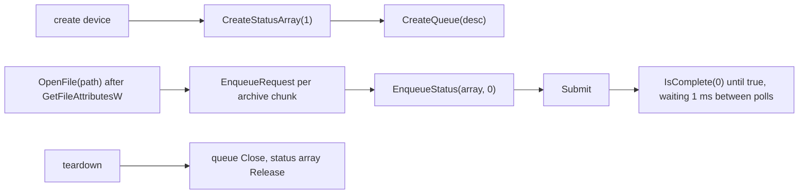

# DirectStorage

The game imports `XCRDAPI.dll!DStorageGetFactory`, the console's DirectStorage. The loader answers with a CPU
implementation (`src/FiveStar.Loader/Shims/Storage`): queues read package files with overlapped, unbuffered I/O on a
worker thread per queue and inflate zlib chunks. Bytes are served exactly as stored.

## How the game uses it

At start-up the game gets the factory and sets a 32 MiB staging size (0x141d8e4d0); a failure there stops it at an
`int3`. Its storage device class (vtable 0x1462fc740, objects tagged `sdsm`) then:

## Interfaces

Slots seen at the executable's call sites; the rest follow the public `dstorage.h` order and are not called.

| Interface | Slot | Method | Arguments | Seen at |
|---|---|---|---|---|
| Factory | 4 | OpenFile | `(this, const wchar_t* path, REFIID, void**)` | 0x1428c8c1e, 0x1428c9d54 |
| Factory | 5 | CreateStatusArray | `(this, UINT32 capacity, const char* name, REFIID, void**)` | 0x1428c9522 |
| Factory | 8 | SetStagingBufferSize | `(this, UINT32 bytes)`; name inferred | 0x141d8e515 |
| Factory | 10 | CreateQueue | `(this, const DSTORAGE_QUEUE_DESC*, REFIID, void**)` | 0x1428c95c7 |
| Queue | 3 | EnqueueRequest | `(this, const DSTORAGE_REQUEST*)` | 0x1428c9a0b |
| Queue | 4 | EnqueueStatus | `(this, IDStorageStatusArray*, UINT32 index)` | 0x1400e8940 |
| Queue | 5 | EnqueueSignal | `(this, ID3D12Fence*, UINT64 value)` | not called |
| Queue | 6 | Submit | `(this)` | 0x1400e894d |
| Queue | 8 | Close | `(this)` | 0x1428c9637 |
| Status array | 2 | Release | `(this)` | 0x1428c961f |
| Status array | 3 | IsComplete | `(this, UINT32 index)` returning a bool | 0x1400e8981 |
| Status array | 4 | GetHResult | `(this, UINT32 index)` | not called |
| File | 3, 4 | Close, GetFileInformation | `(this)`, `(this, BY_HANDLE_FILE_INFORMATION*)` | not called |

Every other slot is a stub that logs its first call and returns E_NOTIMPL; QueryInterface returns E_NOINTERFACE.

### DSTORAGE_QUEUE_DESC

Same layout as `dstorage.h`, filled field by field at 0x1428c9559.

| Offset | Size | Field | Game's value |
|---|---|---|---|
| 0x00 | 4 | SourceType | 0 file, 1 memory |
| 0x08 | 2 | Capacity | requested count + 0x3F |
| 0x0A | 1 | Priority | 0, 1 or 2 |
| 0x10 | 8 | Name | a string |
| 0x18 | 8 | Device | 1 |

### DSTORAGE_REQUEST

The console layout differs from `dstorage.h`: the destination comes before the source. Built at 0x1428c9960, which
zeroes 0x48 bytes.

| Offset | Size | Field | Game's value |
|---|---|---|---|
| 0x00 | 8 | Options | compression in bits 0-7; bit 22 (0x400000) for a memory source |
| 0x08 | 8 | Destination | system memory pointer |
| 0x10 | 8 | (zero) | |
| 0x18 | 4 | DestinationSize | inflated size for zlib, else the source size |
| 0x20 | 8 | Source | IDStorageFile*, or a pointer for a memory source |
| 0x28 | 8 | Source offset | file offset (0 for memory) |
| 0x30 | 4 | Source size | stored size |
| 0x34..0x47 | | (zero) | |

### Compression formats

| Value | Format | Game |
|---|---|---|
| 0 | none | chunks stored raw |
| 1 | zlib (RFC 1950) | chunks whose archive descriptor kind is 3 ([archives.md](archives.md): chunks are zlib streams) |

The game requests no other format and no destination other than system memory. BCPack through DirectStorage is not
used; a request with another format fails with E_NOTIMPL and is logged once.

## The CPU queue

- **OpenFile** maps the path through the [file overlay](loader.md#file-overlay) and opens it with
  `FILE_FLAG_OVERLAPPED | FILE_FLAG_NO_BUFFERING`.
- **EnqueueRequest** copies the 0x48-byte request and holds a reference on its file; **EnqueueStatus** marks the
  entry incomplete. Neither allocates.
- **Submit** hands everything enqueued so far to the queue's worker thread.
- The worker runs entries in order. A file read covers the requested range widened to 4 KiB sectors in one of two
  reusable staging buffers, so the next request's read is in flight while the current one inflates. A request larger
  than the staging size is read in pieces when uncompressed, and fails otherwise.
- zlib chunks inflate with `FiveStar.Formats`' `ZlibInflater` (reused, Adler-32 checked); the output must equal
  DestinationSize.
- A status entry completes with the first failure since the previous status entry, or S_OK. Close and the last
  Release stop the worker after the current request; entries not run complete their status with E_ABORT.
- A fence entry calls `ID3D12Fence::Signal` (slot 10) on the worker.

## GPU destinations

Requests whose options set a bit other than the compression and the memory-source bit go to an
`IStorageDestinationSink` after reading and inflating: `Write(in StorageRequest request, ReadOnlySpan<byte> data)`
gets the final bytes in staging memory (valid during the call) and the request's raw 0x48 bytes to decode the
destination. Its HRESULT goes to the status array. Until the D3D12.X layer provides one, the loader's sink fails such
requests with E_NOTIMPL and logs the first.

## Unknown

- The console's destination types and their option bits, and bits 8-21 and 23-63 of the options.
- Which value would select BCPack, and the fields at 0x10 and 0x34..0x47 of a request.
- Factory slots 3, 6, 7 and 9; queue slots 7 and 9-11 (CancelRequests, GetErrorEvent, RetrieveErrorRecord, Query in
  `dstorage.h`); whether the console auto-submits a full queue.
- Whether queue Close releases the queue: the game never releases it after Close.
