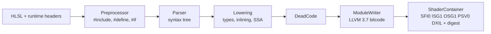

# DXIL backend

`src/FiveStar.Shaders/Dxil` compiles the translator's HLSL straight to a DXIL container, without dxc. dxc's optimizer
spends about 36 CPU-hours on a full translation, and the GPU driver optimizes the DXIL again when it builds a pipeline;
the backend writes plain SSA and leaves the optimizing to the driver. It handles compute programs; other stages go to
dxc.

```
fivestar shader translate <fssm> <out> --backend dxil        compute through the backend, everything else through dxc
fivestar shader translate <fssm> <out> --backend dxil-only   no dxc at all (programs it cannot lower fail)
fivestar shader dxil <hlsl file or folder> [--out <dir>] [--validate] [--jobs N] [--step K] [--limit N] [--repeat N]
                     [--phases] [--ir <file>]
```

`dxil` compiles already translated compute HLSL, checks each container with dxil.dll's validator (`--validate`), and
writes `<out>/dxil-backend.tsv` (name, characters, milliseconds, bytes, status, reason). `--repeat` times the last of N
compiles (after JIT warm-up), `--phases` times preprocess, parse, lower and write, `--ir` lists the IR of one program.

## Design

The translator's IR is its HLSL: emitters write statements as text and the runtime headers (`rdna_prelude.hlsli` and
the others) define the helpers they call. The backend is a compiler for that dialect, so the headers stay the one
definition of every helper (buffer range checks, the address map, the descriptor window, wave emulation) and the loop
guards are already in the code.



| Part | Folder | Notes |
|---|---|---|
| Preprocessor, lexer, parser | `Hlsl` | object-like macros only; casts need a known type name |
| Types, values, places | `Lowering` | every value is its flattened scalars; arrays live in memory (alloca, shared memory, constant tables) |
| SSA | `Lowering/SsaBuilder` | Braun et al.: definitions per block, phis at joins, trivial phis removed |
| Calls | `Lowering/FunctionInliner` | every call inlined (DXIL has one function); `return` jumps to the call's exit |
| Intrinsics | `Lowering/*Intrinsics`, `TextureLowerer`, `RawBufferLowerer` | as dxc's HLOperationLower: math, wave and quad, barriers, atomics, raw buffers, textures |
| Module | `Ir` | types, interned constants, instructions, metadata; `ModuleWriter` writes unabbreviated records |
| Container | `Container` | PSV0 runtime info version 2, validator 1.6, shader model 6.6 |

**Short-circuit evaluation.** `&&`, `||` and `?:` on scalars skip their later operands (HLSL 2021) unless those are
pure: no assignments, memory reads or wave operations, and calls only of arithmetic intrinsics and pure user
functions. Pure operands are computed and combined with `and`, `or` and `select`.

**SSA at joins.** Code is structured, so each join closes a region (if, switch, loop, inlined call) that starts at one
block. The lowering records the slots each region writes; a read of any other slot at the join continues at the
region's start. Without this, a register read after N joins made N phis and removed them again.

**Floating point.** Operations carry no fast-math flags, so the driver may not reassociate or contract them; dxc
compiles with fast-math by default.

**Digest.** `ContainerHash` is the modified MD5 D3D12 checks (`DxilContainerHash`): the bit count first in the last
block, `2 × bytes + 1` last. D3D12 and WARP accept the container without dxil.dll signing, and the validator computes
the same digest (`DxilContainerTests`).

**Root signature.** The same as for dxc's output (`docs/shader-translation.md`, Resources): `g_user4` at b0 space 0, everything else
through `ResourceDescriptorHeap` and `SamplerDescriptorHeap`; no RTS0 part.

## Measurements

Compute programs of the dump (structured form, wave emulation), on a 64 GB machine that was running other
translations and game boots at the same time, so times are upper bounds:

| | dxc -O3 | dxc -Od | backend |
|---|---|---|---|
| All 2,689 compute programs | | | all compile and pass dxil.dll validation |
| Compile time, 33-program sample, total / median | 418 s / 5.0 s | 305 s / 2.6 s | 83 s / 1.4 s |
| Compile time, all 2,689 (4 jobs), median / p90 / max | | | 0.38 s / 3.7 s / 34 s |
| Compile time, one 60 KB program, steady state | 2.6 s | 1.5 s | 0.24 s |
| DXIL bytes, 33-program sample | 14.8 MB | 28.4 MB | 26.4 MB |
| RTX 4090 pipeline creation, 113 programs, total / median | 921 s / 2.0 s | | 973 s / 2.4 s |
| Outputs on WARP, 27 real programs, 3 input sets each | | | equal to dxc -O3 in every word |

The driver's compile takes about as long on the backend's DXIL as on dxc's optimized DXIL, so the backend saves
dxc's time without moving it into pipeline creation. The DXIL is about the size of dxc -Od's: the records are
unabbreviated and nothing is optimized before the driver.

## Coverage

Not lowered yet: function-like macros, matrices, `StructuredBuffer`, typed `Buffer` loads, `SampleCmpLevel`,
`CalculateLevelOfDetail`, and the pixel, vertex, mesh and geometry entry points. A program that uses one of these fails
with the line and the reason, and `--backend dxil` hands it to dxc.

## Testing

`DxilContainerTests` builds a module by hand, validates it and runs it on WARP. `ComputeShaderTests` runs every compute
case of the ISA reference through the backend (`The_dxil_backend_computes_what_the_isa_defines`).
`DxilBackendDifferentialTests` compiles real compute programs both ways (structured form, the differential harness's
synthetic inputs) and compares every output word on WARP; the variables of the control-flow differential size it.

## Open

- Pixel, vertex, mesh and geometry stages: signatures, `loadInput`/`storeOutput`, the PSV0 signature tables.
- VIctory notes that the AMD driver hangs on divergent loops whose exiting block is not the latch; the backend does not
  fold empty latches yet.
- Compile time is dominated by allocation (about 1 KB per instruction) and GC.
