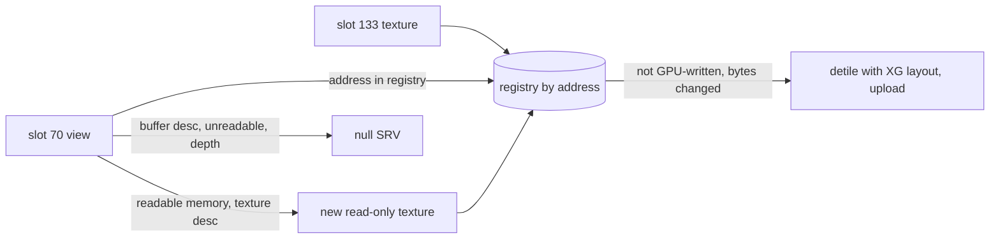

# Resources at console GPU addresses

On the console a texture is memory in the console tiling ([xg.md](xg.md)) at a GPU virtual address. The CPU fills
it (DirectStorage into the scatter-mapped streaming range, game copies), the GPU reads it through descriptors that
carry the address (device slot 70), and render targets and UAVs are written by the GPU. The PC GPU cannot read a
tiled texture from a heap over game memory (such heaps take row-major layouts only, [physical-memory.md](physical-memory.md)),
so the D3D12.X shim keeps a desktop texture per address and copies the memory into it. Buffers stay placed over the
game's pages ([d3d12x-shim.md](d3d12x-shim.md)). Code: `src/FiveStar.Loader/Shims/D3D12X/Resources`.

## Addresses

| Memory | GPU address | Where the CPU reads it |
|---|---|---|
| XMem pages (64 KiB, mapped by the game) | the mapped address | the same address |
| The streaming range | GPU-only alias range | the CPU range at the same offset |
| Memory the game committed (XMemVirtualAlloc with MEM_COMMIT) | the same address | the same address |

The game reserves its 6 GiB streaming range twice: a CPU range (xmemFlags 0x21, PAGE_READWRITE, 0x141E6C1A6) and a
GPU-only range of the same size (0x3, PAGE_NOACCESS | PAGE_GRAPHICS_NOACCESS, 0x141E6C1CB). Pages are mapped only
into the CPU range (scatter mapping at 0x140F2CC3E); the address a texture's view carries is CPU address - CPU base
+ GPU base (0x144ECC8F0, bases at 0x149E1DAC0 and 0x149E1DAD0). The XMem shim pairs a GPU-only reservation with the
mappable CPU reservation of the same size made just before it (`XMemReservation.CpuView`); address lookups
(`XMemPhysicalMemory.TryLocate`, `CpuAddress`) go through the pair, so placed buffers at GPU-range addresses land on
the same pages.

## Textures

- **Registry** (`GpuTextureRegistry`): textures sorted by console address over the span of their XG layout; lookups
  take no lock. A texture registered over an overlapping range retires the old one, which keeps its reference until
  shutdown, since descriptors written earlier may still name it.
- **Slot 133** (`GpuTextures.CreatePlaced`): a committed desktop texture in the state of the initial barrier layout.
  With ALLOW_RENDER_TARGET, ALLOW_DEPTH_STENCIL or ALLOW_UNORDERED_ACCESS it is GPU-written and never filled from
  memory; otherwise it is filled at creation.
- **Slot 70** (`AddressShaderViews`): the registered texture at the view's address with the same extent and format
  (a GPU-written one with the same extent, whatever its format); else, when every byte of the desc's XG layout is
  readable, a new texture without RT/DS/UAV flags in PIXEL | NON_PIXEL_SHADER_RESOURCE, in the view's format when its
  element size equals the resource's. The SRV takes the view's format on a typeless texture and the texture's own
  otherwise (an invalid SRV desc removes the device).
- **Upload** (`GpuTextureUploader`): every subresource detiled by `XgCopier.From` into an upload buffer at the
  desktop's copyable footprint, copied on a private direct queue between transitions out of and back into the
  texture's state, waited for.
- **Refresh points**: creation, and every slot-70 view of the texture. The game creates a texture's view once its
  data has arrived, so a view is where new bytes are taken. A 64-bit hash of the bytes skips unchanged memory.
- **Readability** (`GameMemorySource`): in an XMem reservation every 64 KiB page of the span must be mapped; elsewhere
  every byte must be committed and readable. Anything else gets no texture.

### Trade-offs and limits

- Change detection is explicit (creation, slot 70), not watched: `MEM_WRITE_WATCH` does not apply to mapped
  views, and guard-page tracking would fault on every streamed page. CPU writes after the last view of a texture
  are not seen.
- Uploads are synchronous on their own queue and do not wait for the game's queues: a texture the GPU is reading in
  flight is overwritten without ordering.
- Retired textures are never released before shutdown.
- XG layout spans larger than the game's own (128x1 A8 with 4 KB swizzle: 0x2000 computed, views 0x1000 apart)
  make neighbours retire each other.
- Buffer SRVs at console addresses (slot 70 with a buffer desc) are null descriptors: the desktop SRV needs the
  buffer resource behind the address, which the address table does not keep.
- Depth-stencil (two-plane) textures are not uploaded; a slot-70 view of a depth-format texture is null.
- GPU-written textures are not copied back to game memory; CPU reads of render targets see stale bytes, and
  resource Map on a slot-133 texture fails (default heap).

## Samplers

Slot 61 takes a 0x6c-byte desc (`ConsoleSamplerDescription`), filled by the game's only caller (0x1412B96B0, after
zeroing it) from a 0x2c-byte sampler state; `ConsoleSamplers` writes the desktop D3D12_SAMPLER_DESC.

| Offset | Field | Source in the game's sampler state | Desktop |
|---|---|---|---|
| 0x00 | 0 | | |
| 0x04 | mag filter | flags & 0x4 ? 1 : 2; 3 when flags & 0x40 | 1 point, 2 linear, 3 anisotropic |
| 0x08 | min filter | flags & 0x10 ? 1 : 2; 3 when flags & 0x40 | as above |
| 0x0C | mip filter | flags & 0x1 ? 2 : 1 | |
| 0x10 | unknown | flags & 0x4 ? 2 : 1 | not used |
| 0x14 | filter mode | table 0x146172FA0 [flags >> 7] | 1 MINIMUM, 2 MAXIMUM reduction |
| 0x18, 0x1C, 0x20 | address U, V, W | bytes 1, 2, 3 | D3D12_TEXTURE_ADDRESS_MODE, WRAP when out of range |
| 0x24, 0x28 | min, max LOD | floats at +0x1C | |
| 0x30 | mip LOD bias | float at +0x4 | |
| 0x34 | max anisotropy | byte 8 & 0x1F | clamped to 1..16 |
| 0x40 | comparison | byte 9 when flags & 0x80, else 1 (NEVER) | not NEVER: comparison reduction |
| 0x44 | border color | 4 floats at +0xC | |

The flags are the word at +0xA of the game's state.

## Barriers

The game uses enhanced barriers: slots 127 and 133 take a D3D12_BARRIER_LAYOUT (3 UNORDERED_ACCESS and 6
SHADER_RESOURCE in the boot), mapped to legacy states at creation (`BarrierLayouts`). No barrier slot is reached
during boot: no list slot 26 to 31 logs a stub call. List slot 32 is SetDescriptorHeaps (call at 0x144E4CAC2 with two
heaps from 0x1475E7390 and 0x1475E73D8), so ResourceBarrier is among slots 26 to 31. Barriers are therefore
no-ops for now. That is safe for device stability: buffers on the opened heaps are in COMMON and promote and decay
implicitly, uploads transition their texture themselves, and validation reports a texture used in the wrong state
(a render target created in UNORDERED_ACCESS and cleared) rather than removing the device; results may be wrong
where a real barrier would flush or decompress.

## Unknown

- Which list slot is the barrier, its argument layout, and whether the game also writes barriers inline.
- Whether every GPU-only reservation aliases the CPU reservation before it; only the streaming pair is confirmed.
- The slot-70 view desc's +0x3C (3 or -4 from a texture flag) and the sampler desc's +0x10 and +0x14.
- Whether DirectStorage completion or the game's copy calls should refresh textures without a new view.
