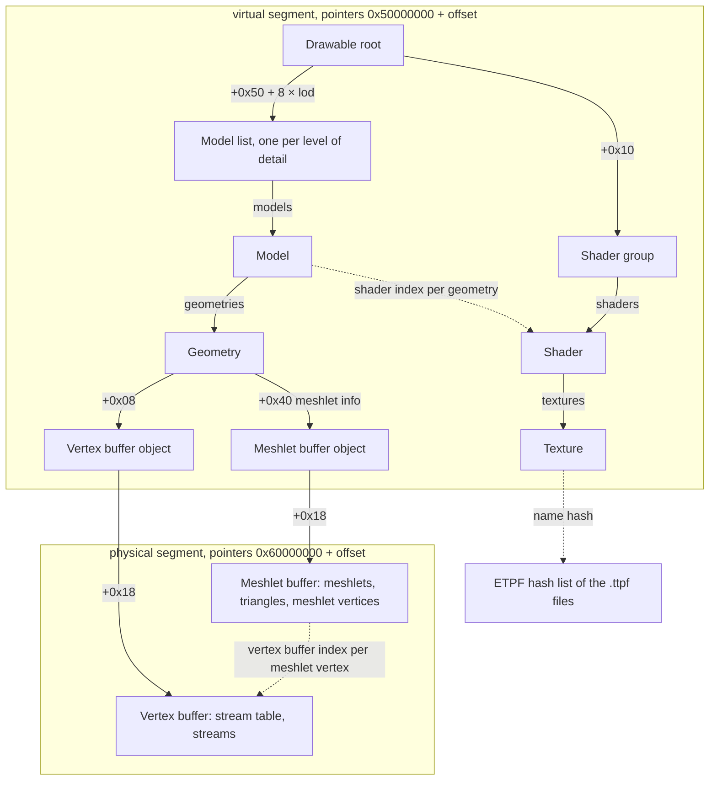

# Models

Drawables (`.#dr`, and the drawables inside fragments `.#ft`) are paged resources: a virtual segment of objects
that point at each other with 64-bit pointers 0x50000000 + offset, and a physical segment of GPU buffers named by
pointers 0x60000000 + offset. `fivestar archive carve` recovers them as an `rsc` blob followed by a `phys` blob
([archives.md](archives.md)); when the virtual segment is a whole number of 64 KiB chunks the carver joins both,
and the reader splits the blob at the first 64 KiB boundary where every geometry decodes. Geometry is meshlets over a vertex buffer of separate attribute streams; there is no
index buffer. `fivestar model` reads it.

All values little-endian; offsets are from the object named.

## Objects



| Object | Offset | Meaning |
|---|---|---|
| Drawable root | +0x10 | Shader group |
| | +0x50 + 8 * lod | Model list of each of 4 levels of detail (null when absent) |
| | +0x70 | 4 floats, by their values the LOD distances |
| | +0xA8 | Name, NUL-terminated (`cvar_am_python_head_01a.#dr`) |
| Shader group | +0x10, +0x18 | Pointer array of shaders, u16 count |
| Model list | +0x00, +0x08 | Pointer array of models, u16 count |
| Model | +0x08, +0x10 | Pointer array of geometries, u16 count |
| | +0x18 | One bounding box (2 x float4) per geometry |
| | +0x20 | u16 shader index per geometry |
| Geometry | +0x08 | Vertex buffer object |
| | +0x40 | Meshlet info: +0x00 meshlet buffer object, +0x08 u16 meshlets, +0x0A u16 triangles, +0x0C meshlet vertices << 8 |
| Buffer object | +0x08 | u32 size in dwords |
| | +0x0C | u16 element size (4), u16 kind: 9 vertices, 8 meshlets |
| | +0x10 | u32 flags (0x1601 vertices, 0x1380 meshlets) |
| | +0x18 | Physical pointer to the data |
| Vertex buffer object | +0x40 | Declaration: 32 u32 stream offsets (0x80 for unused slots), and at +0x138 the vertex count in bits 10-31 |
| Shader | +0x00 | u64 name hash |
| | +0x10 | Pointer array of textures |
| | +0x20 | Parameter table: +0x01 u8 texture count; from +0x08, per texture u32 parameter name hash, u32 index * 4 |
| Texture | +0x30 | Pointer to a reference whose u64 at +0x08 is the texture's name hash |

The texture name hash is the key of the ETPF hash list of the texture page files ([textures.md](textures.md)). The
parameter hashes are Jenkins one-at-a-time hashes of the lower-cased name: `DiffuseTex` 0xC8E8C282, `BumpTex`
0x1E77BF4C.

## Skeleton

| Object | Offset | Meaning |
|---|---|---|
| Drawable root | +0x18 | Skeleton (null in most props) |
| Skeleton | +0x28, +0x6C | Pointer to the bones, u16 bone count |
| Bone (0x50 bytes) | +0x00 | Rotation quaternion x, y, z, w |
| | +0x10, +0x20 | Translation, scale (3 floats each) |
| | +0x30 | Name pointer |
| | +0x44, +0x46 | s16 next sibling, s16 parent (-1 for the root) |

Transforms are relative to the parent. Code: `SkeletonReader`. The models of a vehicle are skinned to the whole
skeleton (model +0x14 = bone count, +0x34 = 0x1FF), and their vertices are already in model space.

## Fragments

A fragment's resource starts with the fragment type at virtual offset 0. Code: `FragmentReader`.

| Object | Offset | Meaning |
|---|---|---|
| Fragment type | +0x10 | Physics |
| | +0x18 | The drawable |
| | +0xA8 | Name without extension (`dominator9_hi`) |
| Physics | +0x20 | Composite bound |
| Composite bound | +0x70, +0x98 | Pointer array of child bounds, u16 count |
| Child bound | +0x10 | Type byte (8 = cylinder along x) |
| | +0x20 | Half extents (3 floats) |

A vehicle has no wheel geometry and no child drawables: `dominator9_hi.#ft` holds one drawable (37 geometries, 386
bones) and so does the low detail `dominator9.#ft`. Rims and tyres are shared drawables in `levels.rpf`
(`rim_muscle_001_hi.#dr`, `tyre_car_001_hi.#dr`; 1,863 counting their `_hi` and `_mid` levels). They are modelled at
a unit size with the axle along x: the rims span 1.0 in y and z, `tyre_muscle_001` 1.75. What a vehicle places them
by:

- The wheel bones `wheel_lf`, `wheel_rf`, `wheel_lr`, `wheel_rr` (and more on trucks) give the hub position.
- The composite bound holds two cylinders per wheel, the brake disc and the tyre (on `dominator9_hi` radius 0.155 m,
  width 0.03 m and radius 0.345 m, width 0.265 m). The tyre cylinders come in the order of the wheel bones:
  `carbonizzare_hi` lists its bones `wheel_lr`, `wheel_rr`, `wheel_lf`, `wheel_rf` and its tyres 0.368, 0.368, 0.345,
  0.345 m, the larger tyres at the rear.

Which rim and tyre a vehicle uses was not found: no rim or tyre name or hash appears in its fragments, and the
vehicle lists of `common.rpf` and `data.rpf` name only spec ids (`DOMINATOR9_BASE_SPEC`).

## Vehicle textures

Every vehicle shader seen (paint, glass, rims, tyres) names the same `DiffuseTex`, `5d7a3a87cc19967d`, which is in no
`.ttpf` file; on the body shaders `TintPaletteTex` is a null pointer. The other texture parameters resolve, almost all
in `data/ttdb/vehicles/ttdb_vehicles*.ttpf`: normal and detail maps (BC5, BC7) and masks (BC1). Several of them are
BCPack pages ([textures.md](textures.md)). The shader constants hold no paint colour (98 parameters on the body
shader, the only 4-float ones are `0 0 1 1` and `0 0 0 0`). So the paint is supplied at run time, and
`graphics draw-model --paint` stands in for it.

The shader's parameter table has a second kind of entry after the textures: `u32 name hash, u32 w` with kind
`w & 0xFF` = 3, byte offset `(w >> 8) & 0xFFF` and size in bytes `w >> 20`, into a block of values the shader's +0x08
points at. Texture entries hold `slot * 4`, which is also the byte offset at which the vehicle pixel shader reads that
texture's handle ([rendering.md](rendering.md#vehicle-material-pass)).

## Vertex buffer

The buffer starts with a stream table of 23 u32, one per slot: 0 when absent, else the format byte in bits 0-7 and
the stream's byte offset / 2 in bits 8-31. Streams are stored one after another (structure of arrays). The format's
high nibble is the element size in 2-byte units.

| Slot | Meaning | Formats seen |
|---|---|---|
| 0 | Position | 0x42 packed, 0x63 three floats |
| 1 | Colour, RGBA8 (white on the props checked) | 0x26 |
| 2 | Normal | 0x21 packed, 0x63 three floats |
| 3 | Texture coordinate 0 | 0x28, 0x42 two floats |
| 4 | Texture coordinate 1 | 0x28, 0x42 |
| 6-19 | Not identified (skinned meshes use 6-9 and 12-19) | 0x25, 0x26, 0x27, 0x28, 0x4B, 0x84 |

| Format | Size | Decoding |
|---|---|---|
| 0x42 position | 8 | Fields A = bits 8-31 of word 0, B = bits 0-7 of word 0 plus bits 0-15 of word 1 above them, C = bits 16-31 of word 1; see below |
| 0x42 elsewhere | 8 | Two floats |
| 0x63 | 12 | Three floats |
| 0x21 | 4 | Octahedral normal: x = bits 0-9, y = bits 10-19, unorm to -1..1; z = 1 - \|x\| - \|y\|, folded when negative. Bits 20-31 not decoded |
| 0x28 | 4 | Two s16, value / 8192 |
| 0x26 | 4 | RGBA8 |

A packed position stream starts at 0x80 and has a header in the 32 bytes before it:

| Offset | Meaning |
|---|---|
| +0x00 | float minimum of fields A, B, C |
| +0x0C | u32: the axis field C holds (0 x, 1 y, 2 z) |
| +0x10 | float step of fields A, B, C; value = minimum + field * step |
| +0x1C | float, 4.0 in every buffer seen |

| Axis word | A | B | C |
|---|---|---|---|
| 0 | z | y | x |
| 1 | z | x | y |
| 2 | x | y | z |

The step is the field's range over 2^24 (A, B) or 2^16 (C); C usually goes to the shortest side of the bounds. Positions are
in metres, z up.

## Meshlet buffer

| Offset | Meaning |
|---|---|
| +0x00 | u32 0x80000000 \| flags \| meshlet count (bits 0-15); vehicles set bits 29 and 30 |
| +0x04 | u32 triangle count |
| +0x08 | u32 meshlet vertex count |
| +0x0C | 16 bytes per meshlet; dword 1 = first triangle << 16 \| first meshlet vertex. Dwords 0, 2 and 3 are not decoded |
| then | u32 per triangle: three 7-bit meshlet-local indices (bits 0-6, 7-13, 14-20), meshlet number in bits 21-31 |
| then | u16 per meshlet vertex: the vertex buffer index it stands for |

A meshlet runs to the next meshlet's first triangle and first vertex; meshlets hold at most 128 triangles in the geometries checked.
Triangles are counter-clockwise seen from the side the normals face.

## Checks

- Normals: per geometry, the mean cosine between each decoded normal and the area-weighted normal of its triangles.
  On the 2,023 geometries in the first 150 MiB of `core_restofworld.rpf` the median is 0.93 and 77% of the vertices
  sit in geometries above 0.8 (0.99 on the prop `cvar_am_toy_dog_01a`). The axis table above is the only field order
  that gives this for all three axis words. Some geometries of set-dressing drawables (`cvar_int_*`) and small gore
  caps score far lower although their triangles form clean meshes.
- Bounds: the decoded positions of `cvar_am_toy_dog_01a` match the bounding box its model stores. Field C is on the
  shortest side in 1,987 of the 2,023 geometries.
- Texture coordinates: the quad of `cvar_movie_poster_01a` maps to u 0.506-1.0, v 0.008-0.997 of its 1024x1024
  texture, which holds two posters side by side.
- Textures: the `DiffuseTex` hashes looked up are in `.ttpf` hash lists, and models drawn with them
  (`graphics draw-model`, [rendering.md](rendering.md)) show the texture where it belongs.

## Coverage

`model scan` over whole archives, every geometry of every level of detail:

| Archive | Drawables | Geometries decoded |
|---|---|---|
| `levels.rpf` | 343,569 | 4,053,995 of 4,056,726 |
| `pack/story000/story000.rpf` | 7,461 | 177,795 of 177,796 |
| `packs.rpf` | 27,470 | 51,107 of 51,107 |
| `pack/shared_minigame000/shared_minigame000.rpf` | 1,296 | 15,024 of 15,024 |
| `data.rpf` | 3,172 | 4,317 of 4,317 |
| `pack/core_restofworld/core_restofworld.rpf` | 936 | 2,021 of 2,021 |
| `pack/story000_restofworld/story000_restofworld.rpf` | 3 | 3 of 3 |

In total 4,304,262 of 4,306,994 geometries (99.94%) of 383,907 drawables decode. Of the failures, 2,651 are
carved physical segments that end before their buffers do, and 81 (in `levels.rpf`) are meshlets whose ranges run
past their buffer.

## Commands

```
fivestar model scan   <archive.rpf> [--from 0xOFFSET] [--limit-mb N] [--list]
fivestar model export <archive.rpf> <out dir> [--from 0xOFFSET] [--limit-mb N] [--name TEXT] [--lod N]
fivestar graphics draw-model <out.png> --archive <file.rpf> --from 0xOFFSET [--name TEXT] [--lod N] [--plain]
                             [--paint RRGGBB] [--rim 0xOFFSET --tyre 0xOFFSET] ...
```

`scan` prints, per level of detail, how many geometries decode and why the rest do not; `--list` adds a line per
drawable. `export` writes `<offset>_<name>.obj` per drawable: positions, normals, texture coordinates (v flipped for
OBJ) and the diffuse texture hash of each shader as a comment. `--from` starts at an entry's offset (as `scan --list`
prints it) instead of the start of the archive.

## Unknown

- Slots 1 and 4-19 beyond their formats: skinning weights and indices, tangents, more colours.
- Bits 20-31 of a packed normal (probably the tangent).
- Meshlet descriptor dwords 0, 2 and 3 (probably culling cone and bounds), and the float 4.0 of the position header.
- Cables (`*_cables_*`): every triangle has zero area, so a vertex shader must widen them; slot 2 is then not a
  normal.
- The same name in several consecutive resources (body parts, garments): whether they are levels of detail.
- Skinning weights and indices, and the names of most shader parameters.
- Where a vehicle's rims, tyres and paint are chosen.
- Fragment children (doors, bonnet) and the rest of the fragment type and physics.
- The 81 meshlet buffers whose descriptor ranges do not fit.
- Meshlet header bits 16-30.
