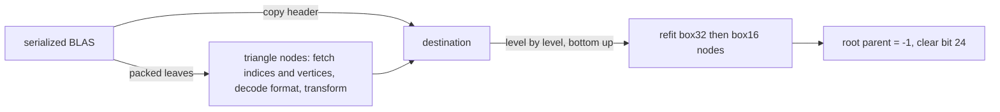

# Ray tracing

The game ray-traces against acceleration structures in AMD's own BVH layout (RT IP 1.1 box16, box32 and triangle
nodes). Translated shaders walk them with the emulated `image_bvh_intersect_ray` ([ray-intersection.md](ray-intersection.md)),
so the port must put structures in that layout at the console GPU addresses the game hands its shaders. The console
builds them with `XboxBvhBuilder.dll` (XDXR). Code: `src/FiveStar.Loader/Shims/Bvh`, `src/FiveStar.Shaders/Bvh`.

## What the game does

| Item | Finding | Source |
|---|---|---|
| Builder object | one `XboxBvhBuilder`, constructor `bool` = 0 (only then does it create its GPU builder) | call 0x14247944F |
| BLAS builds | `BuildRaytracingAccelerationStructureBatched2X`, batches of at most 16, prebuild query first | 0x1424902AC, 0x140FE4FEC, 0x14007595C |
| 64-bit Morton codes | `Set64BitMortonCodes(true)` before builds | 0x14007579C, 0x14249049B |
| Rehydration | `RehydrateRaytracingAccelerationStructureBatched2X`, batches of at most 16 | 0x142490B1A, 0x142490C3C |
| Copies | `CopyRaytracingAccelerationStructure`; the DLL acts only on COMPACT | 0x140BD9709, 0x142490959 |
| DXR state object | device slot 101 creates a `D3D12_STATE_OBJECT_TYPE_RAYTRACING_PIPELINE` with DXIL library subobjects | 0x1424813EF |
| Inline traversal | 64 translated programs execute `image_bvh_intersect_ray` | shader translation |

| TLAS size | the DLL's prebuild query with Type TOP_LEVEL, NumDescs = instance count (low 26 bits of the scene's packed count), Flags from bits 27..26 (0: PREFER_FAST_BUILD, 2: PREFER_FAST_TRACE, else none) | 0x1456AC100, from 0x14022CB0C |
| Instance descs | a game buffer of 64-byte records, one per instance (D3D12_RAYTRACING_INSTANCE_DESC size), allocated per TLAS slot next to the TLAS | 0x14022CA73 |
| TLAS view | an SRV with ViewDimension 11 (RAYTRACING_ACCELERATION_STRUCTURE), mapping 0x1688, Location = TLAS address | 0x1456AC000 |
| BLAS size | prebuild with Type BOTTOM_LEVEL and 0x38-byte triangle geometry descs built from the game's mesh records | 0x144EE2A00 |
| DXR shader identifiers | after slot 101, QueryInterface for ID3D12StateObjectProperties and two GetShaderIdentifier calls (object +0x140, +0x158) | 0x142481429 |

The DLL's batched build takes both types: its desc partition (0x18000CC00) branches on Inputs.Type 0 (instance
count) and 1 (geometry count). The game imports no other build entry, so a TLAS is built through the same batched
call as a BLAS.

## Batched build

The game's build wrapper (two copies, 0x142490110 and 0x140FE4E50) takes an array of geometry records (record +0x08
build scratch size, +0x10 update scratch size, +0x20 the result resource, +0x28 the 24-byte
D3D12_BUILD_RAYTRACING_ACCELERATION_STRUCTURE_INPUTS), destinations, update flags, a scratch base and a scratch
budget, and fills D3D12XBOX_BUILD_RAYTRACING_ACCELERATION_STRUCTURE_BATCHED_DESC2 records of 0x50 bytes:

| Offset | Content |
|---|---|
| 0x00 | DestAccelerationStructureData |
| 0x08 | Inputs (Type, Flags, NumDescs, DescsLayout, pGeometryDescs / InstanceDescs) |
| 0x20 | SourceAccelerationStructureData (the destination when updating, else 0) |
| 0x28 | ScratchAccelerationStructureData (256-aligned slices of the scratch range) |
| 0x30 | number of postbuild-info descs (0 or 1) |
| 0x38 | postbuild-info descs (16 bytes: address, type); type 0 or 3 size, 2 serialization, 0x10 rejected |
| 0x40 | 16 bytes, zero |

An update sets Flags bit 5 (PERFORM_UPDATE). A build with ALLOW_COMPACTION asks for the compacted size into a
readback slot; the wrapper then copies the structure with `CopyRaytracingAccelerationStructure` (mode 1, COMPACT).
A batch is flushed at 16 descs or when the scratch budget is used up. The second form (no compaction) brackets the
batch with `Set64BitMortonCodes(true)` / `(false)`.

## Traversal header

The translated shaders read the root node pointer of a TLAS at byte 0x30 of the structure (dword 12, as in the
serialized BLAS header) from a T#-like record (address bits 47..8). Node address = base + ((pointer >> 3) << 6).
A type-6 node is an instance; CS_TraceShadowRays_Half reads it as:

| Offset | Content |
|---|---|
| 0x30 | dword tested against 0xD5000000 (mask / flag bits in the top byte) |
| 0x38 | bits 29..0 the BLAS root node pointer (0x3FFFFFFF: none); bit 31 set: translation-only transform |
| 0x3C | BLAS base address >> 8 |
| 0x40 | translation x, y, z (f32) |
| 0x4C to 0x6F | the nine remaining f32 of the 3x4 world-to-object matrix, applied to origin and direction |

This is not GPURT's instance node (GPURT keeps the transform at 0). The exact matrix element order and the meaning
of the bytes below 0x30 are not read out yet.

The rehydration caller (0x142490A20) skips a resource unless its serialized header has bit 24 set, puts the GPU
address of the header in `Source` and passes the CPU address of the same bytes (the streaming range's CPU alias,
[gpu-resources.md](gpu-resources.md)) in the extra array argument.

## Serialized BLAS (`core_bvh4.rpf`)

`core_bvh4.rpf` holds resources whose physical segment starts with a serialized BLAS at offset 0x100 (229 headers in
the first 32 MiB carved, every one in that place). Header fields, as the DLL's CPU rehydration reads them:

| Dword | Content |
|---|---|
| 0 | flags: bit 24 serialized (cleared by rehydration), bit 18 writes the root's parent entry, bits 23..20 `n` |
| 1 | total size / 64 − 1; the last dword of the structure is the level count, preceded by one (box32 end, box16 end) offset pair per level |
| 2 | CRC32 of the build inputs (NumDescs and per-geometry counts and formats), checked by `ValidateRehydrateAccelerationStructureBuildDesc` |
| 3 | triangle count |
| 4..9 | bounds: min xyz, max xyz (f32) |
| 10 | offset of the box nodes |
| 11 | nonzero: dword 14 is the copy size; zero: the copy is 144·n² + 64 bytes |
| 12 | root node pointer (type 4 or 5 in every sample) |
| 13 | offset of the triangle nodes |
| 14 | copy size, and offset of the parent-pointer table |
| 15 | vertex transform: 0x7F7F7F none; bit 31 scale exponents in bytes 0..2, bit 30 offset by the bounds centre, bits 29..24 a transform table index |

The packed leaves sit at dword 13, 2048 triangles per 128 KiB chunk, as arrays of 3-byte geometry index, 1-byte
geometry flags, 3-byte primitive index, 3-byte paired primitive index (0xFFFFFF: none) and 1-byte barycentric
swizzle per triangle.

## Rehydration

Rehydration rebuilds the structure in place from the game's own vertex data:

Triangle nodes (64 bytes) as rehydration writes them:

| Offset | Content |
|---|---|
| 0, 12, 24, 36 | V0..V3 (f32 xyz); a pair shares an edge |
| 48 | geometry index << 8 \| geometry flags |
| 52 | primitive index |
| 56 | paired primitive index, 0xFFFFFFFF without one |
| 60 | triangle_id: byte 0 the swizzle of triangle 0, byte 1 of triangle 1 (2 bits per barycentric) |

Running the CPU rehydration on a two-triangle sample from the archive with a stand-in vertex buffer gave: header
0x40 bytes, parent-pointer table at 0x40 (root entry 0xFFFFFFFF), one triangle node per triangle at 0x80 and 0xC0
(V3 = NaN, flags byte 1, paired index 0xFFFFFFFF, triangle_id 9), a box16 root at 0x100 whose unused children are
0xFFFFFFFF with min +inf and max −inf, bit 24 cleared. The vertices were scaled per axis by 2^(byte − 127) from dword 15.

Vertex formats decoded: DXGI 10, 11, 13, 16, 24, 28, 31, 34, 35, 37, 49 and 51 (16-bit, 8-bit and 10-bit normalized
and half formats, R32G32_FLOAT), any other as three f32; indices R16_UINT, R32_UINT or none.

The DLL does this twice: on the GPU (compute shaders recorded on the list, which the desktop cannot run) and on the
CPU (`RehydrateRaytracingAccelerationStructureX`, CPU addresses only, no device use).

## PC design

| Part | How |
|---|---|
| Sizes | the DLL's own `GetRaytracingAccelerationStructurePrebuildInfo` with a stand-in object: CPU arithmetic that reads only its inputs and static globals, so the game allocates console-sized AMD structures (one-triangle BLAS: result 1024, scratch 16840; `--call GetRaytracingAccelerationStructurePrebuildInfo`) |
| Rehydration | the DLL's CPU rehydration per desc, on a copy of the desc whose destination, transform, index and vertex addresses are replaced by their CPU addresses; every range is checked mapped first. The result lands in game memory, where the placed buffers and the shaders' memory window see it |
| BLAS builds | the batched build on the CPU at record time (`BvhBatchBuilder`): geometry read through the CPU addresses of its vertex, index and transform buffers, built by `XdxrBlas`, written to the destination when it fits the console prebuild size; compacted-size and current-size requests get the structure size |
| TLAS builds | skipped (logged once): the instance-node encoding is not fully known |
| Copies | COMPACT copies the structure bytes unchanged (dword 1 gives the size; node pointers are relative to the structure) |
| DXR state objects | not translated: no dispatch has been found |

`--raytracing` turns on the DLL paths. Without it sizes come from the desktop device and nothing is written, as
before.

## Builder

`Bvh4Builder.Build(triangles, nodeOffset)` splits top-down: each box sorts its triangles by centroid along the
longest centroid axis and gives each quarter to a child. Box nodes come first in preorder (the root is the first),
then one triangle node per triangle written as the rehydration writes a lone triangle; pointers count from the BVH
base, so the nodes go `nodeOffset` bytes after it.
`XdxrBlas.Build` puts the nodes after a 64-byte header in the serialized layout: dword 1 size, 3 triangle count, 4..9 bounds, 10 box offset (0x40), 11 = 1 and 14 the copy size, 12 the root (box32 at 0x40), 13 the first triangle node, 15 = 0x7F7F7F. `TriangleDecoder` reads R16/R32 or no indices and R32G32B32_FLOAT, R32G32_FLOAT, R16G16(B16A16)_FLOAT and _SNORM positions, then the 3x4 transform.

The test walks a built BVH with the reference model of the instruction and compares the closest hit of 400 rays
with testing all 500 triangles; a second builds an indexed, transformed mesh through the decoder and finds every triangle from the header's root. A loader test runs a batched desc as the game fills it through `BvhBatchBuilder`.

## Unknown

- The DLL's TLAS encoding (its console compute shaders write the instance nodes; no CPU path exists), so the full
  instance-node layout and the header fields beyond the root pointer.
- The XDXR header the shaders read for a BLAS built at run time beyond the root pointer at 0x30.
- Whether the slot-101 pipeline is dispatched: the identifiers are fetched, but no DispatchRays call has been found
  (the X list slot numbering above 70 is not mapped); the 70 ray-tracing programs found are inline compute.
- Whether the vertex data is always in memory when the game records the rehydration; the CPU path runs at record
  time, the console's GPU path at execution.
- The meaning of dword 0 bits 31, 17, 2 and 1 (set in every sample), and of dword 15's transform table.
- Whether the DXR pipeline is dispatched, and with which shaders.
