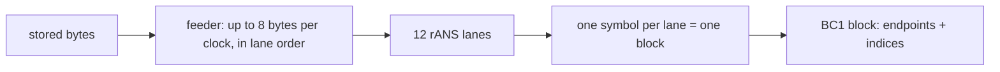

# Streamed textures (`.ttpf`)

The textures live in page files under `data/ttdb/` and `pack/*/data/ttdb/`. A page file maps stored pages into a
virtual address space and lists the textures in that space. `fivestar texture` extracts mip 0 of every readable
texture as DDS and reports what cannot be read yet.

## RDS5 header and page table

All values little-endian.

| Offset | Size | Meaning |
|---|---|---|
| 0x00 | 4 | `RDS5` |
| 0x04 | 4 | n = page entries + 1 (a trailing sentinel slot, normally zero) |
| 0x08 | 4 | Virtual address of the last page (mod 2^32) |
| 0x0C | 12 | Unknown |
| 0x18 | 8 per entry | Page entries `{u32 lo, u32 hi}` |

| Field | Bits | Meaning |
|---|---|---|
| `lo` | 0-23 | File offset / 0x100 |
| `lo` | 24-31 | Flag byte |
| flag | 2-4 | Codec: 0 stored, 1/3/4/5/6/7 BCPack for BC1/BC3/BC4/BC5/BC6H/BC7 |
| flag | 5 | zlib stream |
| flag | 6-7 | Adds 0x1000 steps to the virtual address |
| `hi` | 0-19 | Virtual address / 0x4000 |
| `hi` | 20-31 | Unknown tag |

A page's stored bytes run to the next higher file offset of any entry (or the end of the file); entries with no bytes
are dropped. A page's virtual size is the distance to the next entry's address (0x4000 for the last).

## ETPF section

At `align(0x18 + 8 * (n - 1), 0x100)`; in some files it overlaps the sentinel slot.

| Offset | Size | Meaning |
|---|---|---|
| 0x00 | 4 | `ETPF` |
| 0x04 | 4 | 634 in every file |
| 0x08 | 4 | Descriptor count |
| 0x0C | 4 | Section size |
| 0x10 | 16 per texture | Descriptors |
| then | 8 per texture | 64-bit name hashes, sorted |

| Descriptor word | Bits | Meaning |
|---|---|---|
| `d0` | 0-13 | Width - 1 |
| `d0` | 14-27 | Height - 1 |
| `d0` | 28-31 | Mip count (clamped; often 0 in mode-0 textures) |
| `d1` | 3-9 | DXGI format |
| `d1` | 24-31 | Layout mode: bits 0-2 base (0 = 64 KB tiles, 1-3 = 4 KB tiles, 4 unknown), bit 3 cube map, bit 4 no layout effect |
| `o0` | 0-20 | Virtual address / 0x1000 |
| `o1` | | Unknown |

## Memory layout

A texture's span runs from its address to the next texture's address (the last one to the end of the last page).
Mips are stored smallest first, so mip 0 is the last tile-padded block of the span. The whole chain, mip tail
included, follows the layout in [xg.md](xg.md).

Swizzle patterns give each bit of an element's index inside a tile, least significant first, as the next x or y bit
of its position. An element is a 4x4 block for BC formats and a pixel otherwise. Tiles are laid out row-major.

| Element size | 4 KB tile (bases 1-3) | Tile | 64 KB tile (base 0) | Tile |
|---|---|---|---|---|
| 1 byte | `xxxxyyyyyxyx` | 64x64 | `xxxyyyxyyxyxyxyx` | 256x256 |
| 2 bytes | `xxxyyyxyxyx` | 64x32 | `xxxyyyxyxyxyxyx` | 256x128 |
| 4 bytes | `xxyyyxyxyx` | 32x32 | `xxyyxyyxyxyxyx` | 128x128 |
| 8 bytes | `xyyxxyxyx` | 32x16 | `xyxxyyxyxyxyx` | 128x64 |
| 16 bytes | `yyxxyxyx` | 16x16 | `xyxyyxyxyxyx` | 64x64 |

| Case | Where mip 0 is |
|---|---|
| Mip 0 larger than one tile | The last `padded size` bytes of the span |
| Mip 0 fits in one tile (mip tail) | Swizzled with the shortest pattern prefix that covers it, starting half a tile before the span's end |
| Cube map with one mip | Six faces of `span / 6` bytes, mip 0 at the end of each face (as above) |
| Cube map with mips | Not decoded |

## Page codecs

zlib pages decode with any zlib inflater. Codecs 1 and 3 to 7 are the console's BCPack format, one per BC format (the
codec equals `DSTORAGE_BCPACK_MODE`). BC1 (codec 1) decodes; BC4 and BC5 (codecs 4 and 5) decode approximately; pages
of the other codecs read as missing.

Every codec uses the same entropy layer (below) with its own lanes. Each lane emits one symbol per 8 bytes of output:
one per block for BC1 and BC4, two (E, then O) per 16-byte block for the others. A lane's alphabet index is its symbol
width - 1. Every page of the dump converges with these layouts.

| Codec | Lanes | Symbol width per lane, bits |
|---|---|---|
| 1 BC1 | 12 | 8, 8, 5, 6, 5, 5, 6, 5, 8, 8, 8, 8 |
| 3 BC3 | 12 | 4, 4, 8, 6, 6, 6, 6, 5, 6, 5, 8, 8 |
| 4 BC4 | 12 | 8, 8, 8, 8, 6, 6, 6, 6, 6, 6, 6, 6 |
| 5 BC5 | 12 | 4, 4, 8, 8, 6, 6, 6, 6, 6, 6, 6, 6 |
| 6 BC6H | 16 | 4, 4, 8, 8, 8, 5, 5, 5, 6, 6, 6, 8, 8, 8, 8, 5 |
| 7 BC7 | 16 | 4, 4, 8, 8, 8, 8, 8, 7, 7, 5, 6, 8, 8, 8, 8, 5 |

### BCPack BC1

A BC1 page decodes to `virtual size / 8` BC1 blocks in the page's stored order. They replace the page's virtual
bytes, so untiling works as for any other page. The decoder is in `src/FiveStar.Formats/Ttpf/BcPack`; it implements
the decoder of [bcpack-rs](https://github.com/Ahmet-Dedeler/bcpack-rs), whose lanes follow the decoder module of
Microsoft's [silicon-rans](https://github.com/microsoft/silicon-rans) (`mdu_minirans.v`). Both are MIT licensed;
see `THIRD_PARTY_NOTICES.md`.



| Part | Behaviour |
|---|---|
| Lane state | 32 bits, lower bound L = 2^24, renormalised one byte at a time, 16-bit probabilities |
| Models | static tables `[alphabet index 0-8][q 0-15][segment 0-9]` of `base`, `freq`, `rf`, `rs`, `rn` (`Tables/mdu_models.json`) |
| Fragment header | byte 0: bits 0-3 model q, bit 4 flush (state restarts at 0), bit 5 three-byte header, bits 6-7 narrow the lane's alphabet. Payload length: byte 1 + 1, or `(byte 2 << 8 | byte 1) + 257` |
| Fragment end | the lane drains (decodes without input) until its state is L or below, then reads the next header |
| Lane end | after one symbol per block; the final state must be L, L / 2^8 or L / 2^16 |
| Feeder | every clock, each lane that needs a byte gets the next one, in lane order 0-11, at most 8 per clock; a lane that holds an unreleased symbol waits |
| Release | when all 12 lanes hold a symbol, the symbols form one block |
| Convergence | every lane ends legally and only zero bytes follow the stream |

| Lane | Symbol |
|---|---|
| 0 | Back-reference distance d (zigzag, mod 256): the endpoints start from block i - d, or from a 256-slot preset window when i - d is before block 0 |
| 1 | Unused (always 0) |
| 2-7 | Zigzag residuals added to R0 G0 B0 R1 G1 B1, each wrapping within its 5- or 6-bit field |
| 8-11 | The 2x2 index groups TL, TR, BL, BR, each through a 256-entry codebook |

The entropy tables are exact copies of the hardware's. The preset window (`Tables/bc1_window.json`) and the codebook
(`Tables/bc1_quad_table.json`) were fitted to retail data by bcpack-rs; we refitted 26 window slots, including slot
4, which upstream left empty, and swapped two codebook pairs. Each changed entry keeps the upstream value. Slot 0 is
never read. The fits and the checks are on the wiki page Textures and BCPack.

Three engines give the same bytes: AVX-512 (all lanes in one 16-lane vector), AVX2 (two 8-lane vectors) and a
portable scalar one. The fastest one the processor supports runs.

### BCPack BC4 and BC5

A BC4 page decodes to `virtual size / 8` BC4 blocks, one symbol vector each. A BC5 page decodes to `virtual size / 16`
BC5 blocks, two symbol vectors each: E, then O. Endpoints are bytes that add modulo 256. The lane meanings are those of
the GTA6-Asset-Info notes (`THIRD_PARTY_NOTICES.md`).

| Lane | BC4 | BC5 |
|---|---|---|
| 0 | Distance d, zigzag mod 256 | Distance d: E and O interleaved bit by bit (E on the even bits), then zigzag mod 256 |
| 1 | Unused (always 0) | Unused (always 0) |
| 2 | e0 residual (zigzag) | Channel 0: e0 residual (E), e1 residual (O) |
| 3 | e1 residual | Channel 1: e0 residual (E), e1 residual (O) |
| 4-11 | Lane 4 + k: pixels 2k and 2k + 1 through the pair table | Lanes 4-7 channel 0, 8-11 channel 1; lane of row r: E pixels (r, 0) and (r, 1), O pixels (r, 2) and (r, 3), through the pair table |

The endpoints of block i start from 128 when d is 0, from block i - d, or, when i - d is before block 0, from slot
(i - d) mod 256 of the codec's preset table. Each codec has a 64-entry pair table: symbol s gives the 3-bit indices of
the two pixels, first pixel first.

The pair tables and preset slots (`Tables/bc4_tables.json`, `Tables/bc5_tables.json`) are not published anywhere; they
were fitted to the reference dump against the textures' smaller mips, so BC4 and BC5 output is approximate and
`texture coverage` counts those textures as `approx_codec4` and `approx_codec5`. Because BCPack is lossless, a pair
table is a bijection onto the 64 index pairs, and the fit is constrained to one.

## Duplicate table

`textures.rpf` holds one entry (archive offset 0xB6CA000 in the reference dump, 327,680 bytes) that starts with
`EDUP`, a u32 count (17,431) and then `{u64 duplicate hash, u64 kept hash}` pairs sorted by the first hash. No
duplicate hash is in a `.ttpf` hash list and every kept hash is (6,845 distinct; 6,315 of the pairs keep a 4x4
texture, the rest textures of 64x64 to 1024x1024). A drawable that names a
duplicate (on the vehicles: `c9490fac736ffb5a`, `ad54f974b44dd962`, `2a56e284d28087e1` and others) gets the kept
texture. The lookup in `graphics draw-model` does not read this table yet.

## DDS output

One mip, `DDS_HEADER` with `DDSD_CAPS | HEIGHT | WIDTH | PIXELFORMAT | LINEARSIZE`, pitch field = bytes of one face,
FourCC `DX10`, then `DDS_HEADER_DXT10` {format, 2D, cube flag for 6 faces, array size 1}. Files are named
`<index>_<hash>_<width>x<height>_<format>.dds`.

## Commands

```
fivestar texture extract  <file.ttpf> <out dir> [--limit N] [--only i,j] [--no-dds]
fivestar texture coverage <dir>                  textures whose pages all decode, per file and in total
fivestar texture codecs   <dir>                  pages and stored bytes per storage kind
fivestar texture pages    <file.ttpf>            three sample entries per flag value, then counts per flag and kind
fivestar texture bcpack-scan  <file|dir>... [--codec 1|3|4|5|6|7] [--every N] [--jobs N] [--engine avx512|avx2|scalar] [--hashes FILE] [--quiet]
fivestar texture bcpack-bench <file|dir>... [--pages N] [--seconds S] [--engine avx512|avx2|scalar]
```

Statuses: `ok`, `skip_fmt_N` (format not supported), `skip_modeN` (no swizzle known), `skip_cube_span`,
`skip_size`, `skip_cube_mips`, `skip_unsupported_codec` (mip 0 on a BCPack page without a block decoder), and in
`coverage` `bcpack_codecN` (blocked by such a page) and `approx_codecN` (extracts, through an approximate BCPack
codec).

`bcpack-scan` decodes every page of one codec (BC1 by default) on all cores and prints, per file and in total, the
pages that converge, fail or reach an unfitted preset slot, with the decode speed. `--hashes` writes one line per page
(path, virtual address, status, SHA-256 of the output, unfitted blocks) to compare engines or builds; for a codec
without a block decoder the output is the lane symbols. `bcpack-bench` measures one core on
sampled pages, by page size.

## Unknown

- The BCPack block layers of codecs 3, 6 and 7.
- The exact BC4 and BC5 pair tables and preset slots (ours are fits), and the slots that no fitted texture reads (4
  BC4 and 58 BC5 pages reach one; they decode as zeros and are reported).
- Values of the BC1 preset window and codebook that no page of this dump tests.
- Layout base 4, and what separates bases 1, 2 and 3.
- Mipped cube map layout.
- `o1`, `o0` bits 21-31 and the page tag.
