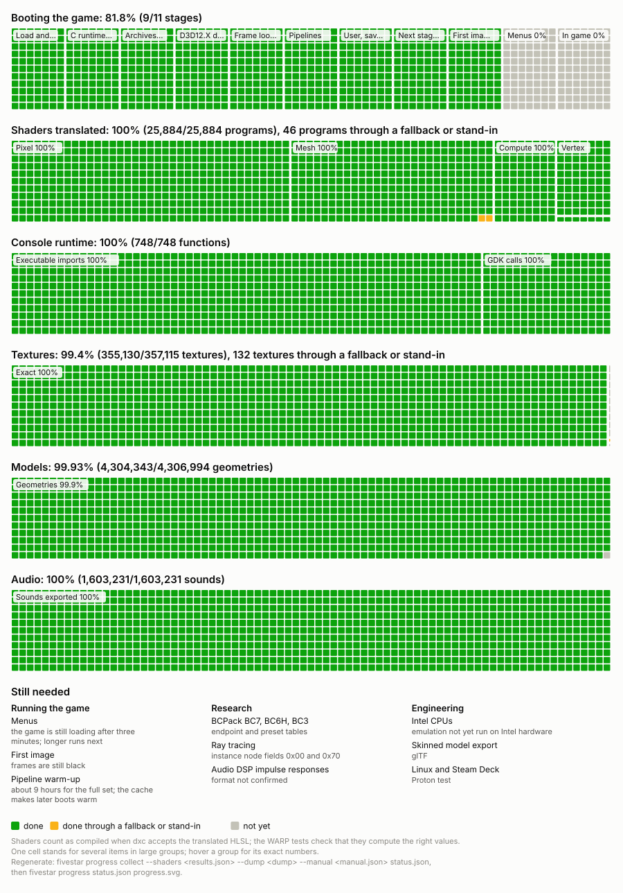

# Status

GTA VI does not run yet. Its main executable (`game_scarlett_master.exe`) is not available to the project, so the
work covers everything that can be built and checked without it.

| Area | Result |
|---|---|
| Shaders extracted | 26,491 records from `shaders.rpf`, 25,884 native GPU programs |
| Shaders translated | all 25,884 compile to DXIL (all stages); the 3 largest compute programs still take 25 to 80 minutes each in dxc |
| Structured control flow | optional; 14,059 programs fully structured, 8,765 mesh programs partly, 23 stay in the dispatch form; DXIL 39% smaller, dxc 16% faster |
| Wave size | compute programs that read lanes by number are pinned to their wave size; 181 of the 203 pinned to 64 lanes also get a wave32 variant that loads on NVIDIA, and 3 more are pinned to 32; the 1,982 pixel, vertex and mesh programs with the same dependence emulate the console wave and all compile: console results on any GPU wave at least as wide as theirs, and 496 of them also on narrower ones (462 of the 907 wave64 pixel programs on 32-lane GPUs) |
| Shader cache | a re-run with nothing changed takes 26 seconds instead of about 70 minutes |
| Driver pipelines | on an RTX 4090, 9,511 of 9,716 sampled pipelines build; the rest are wave64 compute programs on a wave32-only GPU and two out-of-memory compiles |
| Console pipeline cache | 25,471 graphics and 2,693 compute pipelines read from `shaders.rpf`, linked to our programs, with blend, depth and raster state decoded |
| Translator checks | 100 behaviour tests pass on D3D12 WARP and 4 are skipped (they need a full 32 or 64-lane wave); ray intersection is bit-exact |
| Archives | about 68% of all archive bytes extract without the encrypted file table; file names are not known |
| Metadata (PSO) | 6,026 metadata files and about 39,700 paged resources parse completely |
| Textures | 315,483 of 357,115 (88.3%) export across all 57 texture files; most of the rest use BCPack pages |
| Videos | 515 Bink 2 videos extract from `movies.rpf` |
| Audio | all 1,603,231 sounds in `audio.rpf` export as Ogg Opus or WAV (Opus, XMA2, PCM) |
| Loader | the six Xbox libraries in the package load with all 825 imports resolved |
| Console runtime | task queues and async run for real; user, saves, package and store work offline |
| Graphics API (D3D12.X) | a game texture draws through the game's own translated shaders and cached pipeline state on PC; translating the game's calls needs the executable |
| Setup | `fivestar setup` prepares a dump in one resumable command; a re-run with nothing changed takes under a second |
